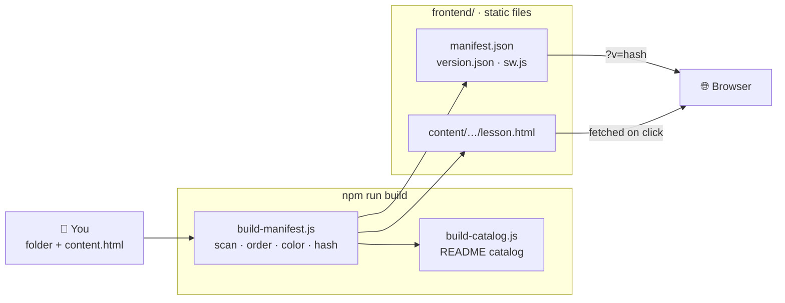
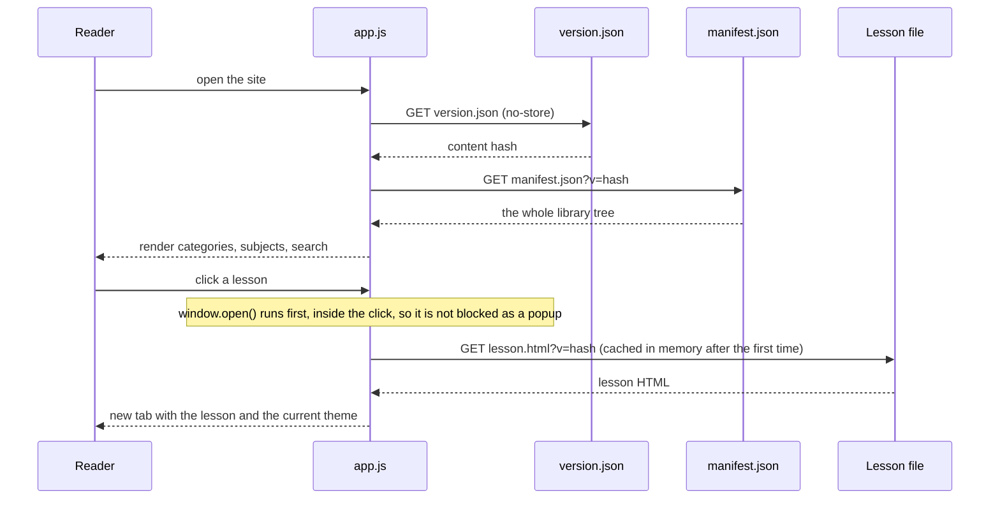

<p align="center">
  
</p>

<p align="center">
  
  
  
  
  
</p>

<p align="center">
  
</p>

<p align="center"><sub><b>CI / CD</b></sub></p>
<p align="center">
  <a href="https://github.com/privateMwb/Canopy/actions/workflows/build.yml">
    
  </a>
  <a href="https://github.com/privateMwb/Canopy/actions/workflows/content.yml">
    
  </a>
  <a href="https://github.com/privateMwb/Canopy/actions/workflows/test.yml">
    
  </a>
  <a href="https://github.com/privateMwb/Canopy/actions/workflows/deploy.yml">
    
  </a>
  <a href="https://github.com/privateMwb/Canopy/actions/workflows/release.yml">
    
  </a>
</p>

<p align="center"><sub><b>Code Quality &amp; Safety</b></sub></p>
<p align="center">
  <a href="https://github.com/privateMwb/Canopy/actions/workflows/lint.yml">
    
  </a>
  <a href="https://github.com/privateMwb/Canopy/actions/workflows/codeql.yml">
    
  </a>
</p>

<p align="center">
  
</p>

<p align="center">Canopy is a self-updating study library: a folder tree of lessons that a single build script turns into a searchable, themeable static site. <b>Add a folder, run <code>npm run build</code>, and it shows up on the page</b> with no frontend code to touch. It covers languages, web development, databases, cloud tooling and core computer science, each subject taught at junior, intermediate and senior level, and it ships as plain HTML, CSS and vanilla JS with no runtime dependencies.</p>

<br>

> [!NOTE]
> **Status: pre-release (`0.1.0`).** The library, the build, content validation, the test suite and the CI
> workflows are in place. There is no tagged release and no live site yet: the Pages workflow is ready, but
> **GitHub Pages has to be switched to "GitHub Actions"** in the repository settings first (see
> [Deployment](#deployment)). Everything below works locally today.

<br>

## 📑 Table of Contents

- [Features](#features)
- [What's Inside](#whats-inside)
- [How It Works](#how-it-works)
- [Requirements](#requirements)
- [Installation](#installation)
- [Quick Start](#quick-start)
- [Adding Content](#adding-content)
- [The Site](#the-site)
- [Project Structure](#project-structure)
- [Development](#development)
- [Continuous Integration](#continuous-integration)
- [Deployment](#deployment)
- [Design Notes](#design-notes)
- [Documentation](#documentation)
- [Contributing](#contributing)
- [Changelog](#changelog)
- [Security](#security)
- [License](#license)

<br>

## <a id="features"></a>✨ Features

- **Self-updating library** — the folder tree under `content/` is the source of truth. `scripts/build-manifest.js` scans it, orders it, colors it and writes the manifest the site reads, so adding a lesson, stage or subject never touches `app.js`.
- **Page or shelf** — a folder either holds a lesson (`content.html`) or holds more folders, never both. The build enforces it and the validator reports a violation instead of silently hiding the page.
- **Search and an A-Z bar** — client-side search over the whole manifest, a letter filter, and an `A↓Z` button to force alphabetical order over the authored order.
- **Light and dark themes** — the page and every lesson follow the reader's choice; the site stamps the current theme into a lesson as it opens.
- **Progress that stays in your browser** — opened lessons and last position are kept per subject in `localStorage`. No accounts, nothing leaves the device.
- **Offline fallback** — a generated service worker serves the network first and falls back to its cache when the connection is gone.
- **Download a subject as a `.zip`** — folders marked `compileRoot` get a one-click archive, built in the browser with a pinned JSZip.
- **Reproducible builds** — the content version is a hash of file *contents*, not timestamps, so a fresh clone rebuilds byte-for-byte what is committed. `npm run check` proves it.
- **Content validation with teeth** — `npm run validate` rejects duplicate lesson and stage numbers, shelves that also hold a page, empty folders, malformed `meta.json`, and any `<script>`, inline handler or `javascript:` link in a lesson.
- **Tested and checked in CI** — a `node:test` suite, oxlint, CodeQL, a generated-files sync check and a content check run on every pull request.
- **No runtime dependencies** — static files you can host anywhere. Node is only needed for the build and the tooling.

<div align="right"><a href="#-table-of-contents"></a></div>

## <a id="whats-inside"></a>📚 What's Inside

Each subject runs from junior to senior, with a curriculum overview to start.

<!-- Generated by `npm run build` from each folder's meta.json. Edit that, not this block. -->
<!-- CATALOG:START -->
<p align="center">
  
  
  
</p>

<p align="center"><sub>Tap a category to explore</sub></p>

<details>
<summary><b>💻 Computer Science</b><br><sub>10 subjects · 544 lessons</sub></summary>

<sub>The broader subject tree — ML, languages, and whatever else gets added later.</sub>

<details>
<summary><b>Data Structures &amp; Algorithms</b> <sub>· 48 lessons</sub><br><sub>Arrays to algorithmic thinking, the structures behind real systems.</sub></summary>

**Junior**

- **Stage 1.1 — Core Data Structures** · Big O Notation · Arrays & Strings · Linked Lists · Stacks & Queues · Hash Tables
- **Stage 1.2 — Foundational Algorithms** · Searching · Basic Sorting · Recursion · Two-Pointer Technique · Sliding Window
- **Stage 1.3 — Problem-Solving Patterns** · Prefix Sums · Fast & Slow Pointers · Frequency Counting · Basic Greedy Problems

**Intermediate**

- **Stage 2.1 — Trees** · Binary Trees · Binary Search Trees · Tree Traversals · Balanced Trees · Tries
- **Stage 2.2 — Graphs** · Graph Representations · BFS & DFS on Graphs · Topological Sort · Union-Find · Dijkstra's Algorithm
- **Stage 2.3 — Sorting & Searching Deep Dive** · Merge Sort & Quick Sort · Heaps & Priority Queues · Binary Search on the Answer · Counting & Radix Sort
- **Stage 2.4 — Intro to Dynamic Programming** · Memoization vs. Tabulation · 1D Dynamic Programming · 2D Dynamic Programming · Knapsack Patterns

**Senior**

- **Stage 3.1 — Advanced Dynamic Programming** · DP on Trees · DP on Graphs · Bitmask DP · DP Optimization Techniques
- **Stage 3.2 — Advanced Graph Algorithms** · Minimum Spanning Tree · Bellman-Ford & Floyd-Warshall · Network Flow · Strongly Connected Components
- **Stage 3.3 — Advanced Data Structures** · Segment Trees · Fenwick Trees (BIT) · Suffix Structures · Skip Lists
- **Stage 3.4 — Algorithmic Thinking & Interviews** · Complexity Tradeoffs in System Design · Approaching Novel Problems · Mock Interview Technique · Explaining Solutions Clearly

</details>

<details>
<summary><b>Operating Systems</b> <sub>· 55 lessons</sub><br><sub>Processes, threads, and memory, from fork() to page tables.</sub></summary>

**Junior**

- **Stage 1.1 — Core OS Concepts** · What an Operating System Does · User Mode, Kernel Mode & System Calls · Kernel Structure & the Boot Process · Files & File Descriptors
- **Stage 1.2 — Processes** · What Is a Process · Process States & Context Switching · Creating Processes: fork, exec & wait · Signals & Exit Status · Pipes & Basic IPC
- **Stage 1.3 — Threads** · Threads vs. Processes · Creating & Joining Threads · Race Conditions · Mutexes & Critical Sections · Threading Models
- **Stage 1.4 — Memory Fundamentals** · Process Address Space Layout · The Stack & Function Calls · Dynamic Allocation: malloc & free · Memory Bugs · Fragmentation & Basic Allocation Strategies

**Intermediate**

- **Stage 2.1 — CPU Scheduling** · Scheduling Goals & Metrics · FCFS, SJF & Round Robin · Priority Scheduling & Multilevel Feedback Queues · Linux Scheduling: CFS & EEVDF · Multiprocessor Scheduling & CPU Affinity
- **Stage 2.2 — Synchronization & Deadlock** · Semaphores · Condition Variables & Monitors · Classic Synchronization Problems · Deadlock: Conditions, Prevention & Detection · Spinlocks vs. Sleeping Locks
- **Stage 2.3 — Virtual Memory** · Why Virtual Memory · Paging & Page Tables · Multi-Level Page Tables & the TLB · Page Faults & Demand Paging · Page Replacement Algorithms · Copy-on-Write & Shared Pages
- **Stage 2.4 — Allocators & Mapped Memory** · How malloc Works · Allocator Designs: Free Lists, Buddy & Slab · mmap & Shared Memory · Memory Management Across Languages

**Senior**

- **Stage 3.1 — Advanced Concurrency** · Atomics & Memory Ordering · Lock-Free Data Structures & the ABA Problem · Futexes & How Locks Are Built · Thread Pools, Work Stealing & Async I/O
- **Stage 3.2 — Memory Hierarchy & Pressure** · Caches, Coherence & False Sharing · NUMA & Memory Placement · Huge Pages & TLB Reach · Overcommit, Swapping & the OOM Killer
- **Stage 3.3 — Isolation & Virtualization** · Namespaces: What a Container Really Is · cgroups & Resource Limits · Sandboxing & Memory Protection · Virtualization & Hypervisors
- **Stage 3.4 — Diagnosis & Design Judgment** · Observing a Live System: strace, perf, /proc & eBPF · Diagnosing CPU, Memory & Lock Contention · Debugging Deadlocks, Leaks & Crashes · Processes vs. Threads vs. Async: Design Tradeoffs

</details>

<details>
<summary><b>Computer Networks</b> <sub>· 53 lessons</sub><br><sub>TCP/IP, HTTP, and APIs, from packets to production services.</sub></summary>

**Junior**

- **Stage 1.1 — How Networks Work** · Layers & the Network Stack · Addressing: MAC, IP & Ports · Packets, Frames & Encapsulation · Latency, Bandwidth & Throughput
- **Stage 1.2 — IP & Name Resolution** · IPv4 Addressing & Subnets · Routing Basics & NAT · DNS: Turning Names into Addresses · DHCP & ARP: Joining a Network
- **Stage 1.3 — TCP & UDP Basics** · UDP: Fast and Unreliable · TCP Connections: Handshake & Teardown · TCP Reliability: Sequence Numbers, ACKs & Retransmission · Sockets: Writing a Client and Server · Ports, Listening & Connection States
- **Stage 1.4 — HTTP Fundamentals** · The HTTP Request-Response Cycle · Methods & Status Codes · Headers, Cookies & Content Negotiation · URLs, Query Strings & Encoding · Inspecting HTTP with curl & DevTools

**Intermediate**

- **Stage 2.1 — TCP in Depth** · Flow Control & the Sliding Window · Congestion Control · RTT, Timeouts & Retransmission · Connection Management in Practice
- **Stage 2.2 — HTTP Evolution & Performance** · HTTP/1.1: Persistent Connections & Head-of-Line Blocking · HTTP/2: Multiplexing & Header Compression · HTTP/3 & QUIC · HTTP Caching · Proxies, Reverse Proxies & Load Balancers
- **Stage 2.3 — TLS & Network Security** · The TLS Handshake · Certificates & Chains of Trust · HTTPS in Practice · Common Network Attacks & Defenses
- **Stage 2.4 — Designing APIs** · REST Principles & Resource Modeling · Errors, Pagination & Filtering · Authentication & Authorization · Idempotency & Versioning · CORS & Browser Constraints

**Senior**

- **Stage 3.1 — Advanced APIs & Protocol Choice** · gRPC & Protocol Buffers · GraphQL Tradeoffs · WebSockets, SSE & Real-Time Updates · Webhooks & Asynchronous APIs · Rate Limiting & Backpressure
- **Stage 3.2 — Scale & Reliability** · Load Balancing: L4 vs. L7 · Global Traffic: Anycast, GeoDNS & CDNs · Timeouts, Retries & Circuit Breakers · Service Discovery & Service Meshes
- **Stage 3.3 — Network Internals & Debugging** · The Kernel Network Path & Socket Buffers · Packet Capture & Analysis · MTU, Fragmentation & Path MTU Discovery · Diagnosing Network Incidents
- **Stage 3.4 — Security Architecture & Design Judgment** · Zero Trust & Mutual TLS · API Security: The OWASP API Top 10 · Firewalls, Segmentation & VPNs · Designing and Defending a Network Architecture

</details>

<details>
<summary><b>Computer Architecture</b> <sub>· 50 lessons</sub><br><sub>CPUs, caches, and pipelines, from logic gates to performance.</sub></summary>

**Junior**

- **Stage 1.1 — Data Representation & Logic** · Bits, Bytes & Number Systems · Integers: Unsigned, Two's Complement & Overflow · Floating Point & Its Surprises · Logic Gates & Building an Adder
- **Stage 1.2 — The Instruction Set & the CPU** · The Fetch-Decode-Execute Cycle · Registers, Memory & Addressing Modes · Instructions: Arithmetic, Control Flow & the Stack · From C to Assembly · RISC vs. CISC: x86-64, ARM & RISC-V
- **Stage 1.3 — The Memory Hierarchy** · Why Memory Is a Hierarchy · Locality: Temporal & Spatial · Caches: Lines, Hits & Misses · Data Layout: Arrays, Structs & Alignment
- **Stage 1.4 — Performance Basics** · The CPU Performance Equation · Measuring Performance Honestly · Amdahl's Law · Power, Frequency & the End of Free Speedups

**Intermediate**

- **Stage 2.1 — Pipelining & Hazards** · The Five-Stage Pipeline · Data Hazards, Forwarding & Stalls · Control Hazards & Branch Prediction · Branch Misprediction in Real Code
- **Stage 2.2 — Cache Design in Depth** · Set-Associative Caches & Replacement · Write Policies: Write-Through, Write-Back & Allocation · The Three Cs: Compulsory, Capacity & Conflict Misses · Multilevel Caches & AMAT · Prefetching & Cache-Friendly Code
- **Stage 2.3 — DRAM & the Memory System** · DRAM: Rows, Banks & Refresh · Memory Bandwidth vs. Latency · Address Translation Hardware: TLBs & Page Walks · Storage: SSDs, HDDs & the Latency Gap
- **Stage 2.4 — Instruction-Level Parallelism** · Superscalar & Out-of-Order Execution · Register Renaming, the Reorder Buffer & Speculation · SIMD & Vectorization · Hardware Performance Counters

**Senior**

- **Stage 3.1 — Multicore, Coherence & Consistency** · Cache Coherence: MESI & Directories · The Cost of Coherence · Memory Consistency Models: TSO vs. Weak Ordering · Atomic Instructions & Synchronization Hardware
- **Stage 3.2 — Speculation & Hardware Security** · Inside an Out-of-Order Core · Speculative Execution & Spectre-Class Flaws · Side Channels: Caches, Timing & Rowhammer · Mitigations & Their Performance Cost
- **Stage 3.3 — Accelerators & Parallel Hardware** · GPUs: SIMT, Warps & Memory · Matrix Engines & Why ML Runs on Accelerators · Heterogeneous Systems & Data Movement · FPGAs, ASICs & the Efficiency Tradeoff
- **Stage 3.4 — Performance Engineering & Design Judgment** · The Roofline Model · Top-Down Microarchitecture Analysis · Data-Oriented Design · Explaining Hardware Tradeoffs

</details>

<details>
<summary><b>Linux &amp; DevOps</b> <sub>· 57 lessons</sub><br><sub>The command line, containers, and CI/CD, from shell to deployment.</sub></summary>

**Junior**

- **Stage 1.1 — The Command Line** · Navigating the Filesystem & the FHS · Files, Permissions & Ownership · Searching & Viewing: grep, find & less · Pipes, Redirection & Streams · Processes & Job Control
- **Stage 1.2 — Shell Scripting** · Variables, Quoting & Expansion · Conditionals, Loops & Exit Codes · Functions & Arguments · Text Processing: sed, awk & cut · Writing Safe Scripts
- **Stage 1.3 — Administering a Linux Machine** · Users, Groups & sudo · Package Management · Services with systemd · Logs: journalctl & /var/log · SSH & Key-Based Access
- **Stage 1.4 — Git & Collaboration** · Commits, Branches & History · Merging vs. Rebasing · Remotes, Pull Requests & Code Review · Undoing Mistakes: reset, revert & reflog

**Intermediate**

- **Stage 2.1 — Containers with Docker** · Images, Layers & the Container Runtime · Running Containers: Ports, Volumes & Environment · Writing Dockerfiles · Build Caching & Multi-Stage Builds · Container Networking & Docker Compose · Registries, Tags & Image Hygiene
- **Stage 2.2 — CI/CD Pipelines** · Anatomy of a Pipeline · GitHub Actions: Workflows, Jobs & Runners · Tests, Caching & Artifacts in CI · Secrets & Credentials in Pipelines · Building & Publishing Images from CI
- **Stage 2.3 — Deploying to Servers** · Reverse Proxies & TLS with nginx · Deploying to a VM: SSH, systemd & Containers · Rolling, Blue-Green & Canary Releases · Configuration & Environments · Rollbacks & Database Migrations
- **Stage 2.4 — Infrastructure as Code** · Cloud Building Blocks · Terraform Basics: Providers, Resources & Variables · State, Plans & Drift · Configuration Management & Idempotency with Ansible · Modules, Environments & Safe Changes

**Senior**

- **Stage 3.1 — Orchestration with Kubernetes** · Why Orchestrators: Desired State & Reconciliation · Pods, Deployments & Services · Config, Secrets & Persistent Storage · Requests, Limits & Scheduling · Probes, Autoscaling & Safe Rollouts
- **Stage 3.2 — Observability & Reliability** · Metrics, Logs & Traces · SLIs, SLOs & Error Budgets · Alerting That Doesn't Cry Wolf · Incident Response & Blameless Postmortems
- **Stage 3.3 — Security & Supply Chain** · Least Privilege for Hosts & Containers · Secrets Management & Workload Identity · Image Scanning, SBOMs & Supply-Chain Risk · Hardening Pipelines & Policy as Code
- **Stage 3.4 — Operating & Designing Platforms** · Debugging Production: Linux & Container Internals · Capacity, Cost & Performance Tradeoffs · Designing a Delivery Platform · Runbooks, ADRs & Leading Operational Change

</details>

<details>
<summary><b>SQL &amp; Relational Databases</b> <sub>· 51 lessons</sub><br><sub>SQL, indexes, and transactions, from your first SELECT to production.</sub></summary>

**Junior**

- **Stage 1.1 — Relational Foundations** · What a Database Is & Why We Use One · The Relational Model: Tables, Keys & Relationships · SQL Basics: SELECT, WHERE & Sorting · Modifying Data: INSERT, UPDATE & DELETE · Data Types, NULL & Constraints
- **Stage 1.2 — Querying with SQL** · Joins: Combining Tables · Aggregation & GROUP BY · Subqueries & CTEs · Set Operations, CASE & Handling NULLs
- **Stage 1.3 — Designing Schemas** · Entity-Relationship Modeling · Normalization: 1NF Through 3NF · One-to-Many, Many-to-Many & Junction Tables · Denormalization & When to Break the Rules · Schema Migrations: Changing a Schema Safely
- **Stage 1.4 — Using a Database from Code** · Connecting from an Application · Parameterized Queries & SQL Injection · Transactions & ACID Basics · ORMs vs. Raw SQL

**Intermediate**

- **Stage 2.1 — Indexes & Query Performance** · How B-Tree Indexes Work · Composite, Covering & Partial Indexes · Reading EXPLAIN Plans · The Query Planner & Table Statistics · Common Slow-Query Patterns
- **Stage 2.2 — Transactions & Concurrency** · Isolation Levels & Anomalies · Locking, Deadlocks & Lock Contention · MVCC: Readers Without Blocking · Optimistic vs. Pessimistic Concurrency
- **Stage 2.3 — Advanced SQL & Data Modeling** · Window Functions · Recursive CTEs & Hierarchical Data · JSON & Semi-Structured Data in SQL · Views, Triggers & Stored Procedures
- **Stage 2.4 — Beyond Relational** · The NoSQL Landscape · Document Databases & Data Modeling · Redis & Caching Patterns · Choosing Between SQL and NoSQL

**Senior**

- **Stage 3.1 — Storage Engine Internals** · Pages, Heap Files & the Buffer Pool · B-Trees vs. LSM-Trees · Write-Ahead Logging & Crash Recovery · Query Execution & Join Algorithms
- **Stage 3.2 — Replication, Partitioning & Distributed Data** · Replication: Leaders, Followers & Lag · Partitioning & Sharding · CAP, PACELC & Consistency Models · Distributed Transactions: 2PC & Sagas
- **Stage 3.3 — Operating Databases in Production** · Backups, Point-in-Time Recovery & Disaster Recovery · Zero-Downtime Schema Migrations · Connection Pooling, Capacity & Monitoring · Database Security: Roles, Row-Level Security & Encryption
- **Stage 3.4 — Data Architecture & Design Judgment** · OLTP vs. OLAP & Columnar Warehouses · Change Data Capture, Event Sourcing & the Outbox Pattern · Diagnosing a Slow or Failing Production Database · Designing and Defending a Data Architecture

</details>

<details>
<summary><b>Information Security</b> <sub>· 57 lessons</sub><br><sub>Cryptography, web security, and threat modeling, from hashing to defense.</sub></summary>

**Junior**

- **Stage 1.1 — Thinking Like a Defender** · Assets, Attackers & Trust Boundaries · Confidentiality, Integrity & Availability · Threat Modeling 101: Data-Flow Diagrams & STRIDE · Secure Design Principles
- **Stage 1.2 — Hashing & Randomness** · Encoding, Hashing & Encryption: Three Different Things · Hash Functions: What They Guarantee · Using Hashes: Integrity & Fingerprints · Randomness & CSPRNGs
- **Stage 1.3 — Passwords & Authentication** · Storing Passwords: Salts & Slow Hashes · Sessions & Login State on the Server · Multi-Factor Authentication & TOTP · Account Recovery & User Enumeration · Credential Attacks: Brute Force, Stuffing & Spraying
- **Stage 1.4 — Classic Web Vulnerabilities** · The Web Attack Surface: Never Trust Input · Injection Beyond SQL · Cross-Site Scripting (XSS) · Cross-Site Request Forgery (CSRF) · Validating Input & Encoding Output

**Intermediate**

- **Stage 2.1 — Symmetric & Public-Key Cryptography** · Symmetric Encryption: Block Ciphers & Modes · Authenticated Encryption: AES-GCM & ChaCha20-Poly1305 · MACs & HMAC · Public-Key Cryptography & Key Exchange · Digital Signatures
- **Stage 2.2 — Keys, Trust & Protocols** · Key Derivation: KDFs, HKDF & Stretching · Key Management: Generation, Storage & Rotation · Reading TLS 1.3 as Cryptography · Trusting Public Keys: TOFU, Pinning & Private CAs · End-to-End Encryption & What It Doesn't Protect
- **Stage 2.3 — Modern Authentication & Authorization** · Sessions vs. Tokens: Storage, Rotation & Revocation · OAuth 2.0 & OpenID Connect: Flows and Their Attacks · JWT Pitfalls: Algorithm & Key Confusion · Passkeys & WebAuthn · Authorization Models: RBAC, ABAC & Policy Placement
- **Stage 2.4 — Web Application Security in Depth** · Content Security Policy & Defending Against XSS · Clickjacking, Frames & Security Headers · SSRF & Trusting User-Supplied URLs · Deserialization, Templates & XML Pitfalls · File Uploads & Untrusted Content

**Senior**

- **Stage 3.1 — Threat Modeling & Risk** · Threat Modeling in Practice: Scoping, STRIDE per Element & Attack Trees · Attacker Models: Capabilities, Motives & Kill Chains · Risk Assessment: Likelihood, Impact & Prioritization · Security Requirements & Abuse Cases
- **Stage 3.2 — How Cryptography Fails** · Padding Oracles & Other Decryption Oracles · Timing & Side Channels in Application Code · Protocol Pitfalls: Replay, Reflection & Downgrade · Randomness Failures & Key Compromise · Post-Quantum Cryptography & Crypto Agility
- **Stage 3.3 — Detection, Response & Data Protection** · Logging, Detection & Audit Trails · Abuse, Fraud & Business-Logic Attacks · Multi-Tenant Isolation & Authorization at Scale · Incident Response for Security Events · Data Protection & Privacy Engineering
- **Stage 3.4 — Security Engineering & Communication** · Secure-by-Default Design & Paved Roads · Security Code Review · Security Testing: Fuzzing, SAST, DAST & Pen Tests · Vulnerability Management & Disclosure · Explaining Risk to Engineers & Executives

</details>

<details>
<summary><b>Software Engineering Practice</b> <sub>· 60 lessons</sub><br><sub>Testing, Git, and design for code that is easy to change.</sub></summary>

**Junior**

- **Stage 1.1 — Writing Your First Tests** · Why We Test: Confidence, Regression & Fast Feedback · Anatomy of a Unit Test: Arrange, Act, Assert · Choosing Cases: Boundaries & Equivalence Classes · Test-Driven Development: Red, Green, Refactor
- **Stage 1.2 — Writing Readable Code** · Naming Things: Variables, Functions & Types · Small Functions with One Job · Comments: What to Say and What the Code Should · Duplication, DRY & the Rule of Three · Code Smells: Recognizing Trouble Early
- **Stage 1.3 — Commit Hygiene & Shipping Changes** · Atomic Commits & Messages Worth Reading · .gitignore, Tags & Semantic Versioning · Writing a Pull Request Reviewers Can Finish · Receiving Review: Feedback Without Friction
- **Stage 1.4 — Structuring Programs** · Abstraction & Encapsulation · Composition over Inheritance · Coupling & Cohesion · The SOLID Principles as Rules of Thumb · Pure Functions, Immutability & Side Effects

**Intermediate**

- **Stage 2.1 — Testing Strategy** · The Test Pyramid & Where Tests Belong · Test Doubles: Stubs, Mocks, Fakes & Spies · Designing for Testability: Dependency Injection & Seams · Integration & Contract Tests · Flaky Tests: Causes & Cures · Coverage, Mutation Testing & What Metrics Can't Tell You
- **Stage 2.2 — Refactoring** · Refactoring Safely: Small Steps Under Test · The Core Moves: Extract, Inline, Rename & Move · Replacing Conditionals & Primitives · Characterization Tests & Legacy Code · Technical Debt: Recognizing and Tracking It
- **Stage 2.3 — Design Patterns** · Why Patterns Exist: A Shared Vocabulary · Creational Patterns: Factory, Builder & Singleton · Structural Patterns: Adapter, Decorator & Facade · Behavioral Patterns: Strategy, Observer & Command · State & Template Method: Behavior That Varies by Context · Over-Engineering: When Not to Use a Pattern
- **Stage 2.4 — Git Under the Hood & Review Craft** · How Git Works: Objects, Trees & the Commit Graph · Shaping History: Interactive Rebase, Fixup & Cherry-Pick · Hunting Regressions: bisect, blame & the Pickaxe · Reviewing Code: What to Look For and How to Say It · Automating the Nitpicks: Hooks, Linters & Formatters

**Senior**

- **Stage 3.1 — Advanced Testing** · Property-Based Testing & Fuzzing · Testing Concurrent & Time-Dependent Code · Hermetic Tests & Managing Test Data · Testing in Production: Canaries, Flags & Observability · Suite Health: Budgets, Ownership & Test Culture
- **Stage 3.2 — Architecture & Design at Scale** · Layered, Hexagonal & Clean Architecture · Domain-Driven Design: Bounded Contexts & Ubiquitous Language · Stable Interfaces & Backward Compatibility · Dependencies & the Cost of Coupling · Evolutionary Architecture: Fitness Functions & Decision Records
- **Stage 3.3 — Version Control at Scale** · Trunk-Based Development & Feature Flags · Monorepo vs. Polyrepo · Release Management: Branching, Backports & Hotfixes · Conventional Commits, Changelogs & Automated Releases · Repository Surgery: Packfiles, filter-repo & Recovery
- **Stage 3.4 — Engineering Judgment & Communication** · Large-Scale Refactors: Strangler Fig & Branch by Abstraction · Refactor or Rewrite: Deciding Under Uncertainty · Leading Code Review: Standards, Mentoring & Culture · Writing Design Docs & RFCs · Explaining Technical Tradeoffs to Non-Engineers

</details>

<details>
<summary><b>Compilers &amp; Language Implementation</b> <sub>· 54 lessons</sub><br><sub>Parsing, type checking, and code generation, from lexer to native code.</sub></summary>

**Junior**

- **Stage 1.1 — The Big Picture** · What a Language Implementation Does · Meet Twig · Grammars & EBNF · Abstract Syntax Trees
- **Stage 1.2 — Lexing & Parsing** · Scanning: Characters to Tokens · Source Positions & Lexical Errors · Recursive Descent Parsing · Operator Precedence & Pratt Parsing · Syntax Errors & Recovery
- **Stage 1.3 — Evaluating Programs** · Evaluating Expressions · Environments & Lexical Scope · Control Flow & Loops · Functions, Calls & Return · Closures & Captured Variables
- **Stage 1.4 — Data, Diagnostics & Testing** · Values, Truthiness & Dynamic Typing · Arrays & Records · Error Messages That Help · Testing a Language Implementation

**Intermediate**

- **Stage 2.1 — Static Analysis & Type Checking** · Name Resolution & Symbol Tables · Static vs. Dynamic Typing · Type Checking Expressions & Statements · Type Inference & Unification · Generics & Subtyping
- **Stage 2.2 — Intermediate Representations** · Why Intermediate Representations · Three-Address Code & Lowering · Control-Flow Graphs & Basic Blocks · Static Single Assignment
- **Stage 2.3 — Bytecode Virtual Machines** · Stack Machines vs. Register Machines · Designing an Instruction Set · Compiling the AST to Bytecode · The VM Loop & Dispatch · Calls, Frames & Closures in a VM · Garbage Collection: Mark-Sweep
- **Stage 2.4 — Optimization** · Constant Folding & Propagation · Dataflow Analysis & Dead Code Elimination · Inlining & Loop Optimizations · Proving an Optimization Correct

**Senior**

- **Stage 3.1 — Native Code Generation** · Instruction Selection · Register Allocation · Calling Conventions & ABIs · Object Files, Linking & Loading · Targeting an Existing Backend
- **Stage 3.2 — Advanced Runtime Systems** · Generational & Copying Garbage Collection · Concurrent GC & Pause-Time Tradeoffs · Making Interpreters Fast · JIT Compilation & Tiered Execution
- **Stage 3.3 — Advanced Language Features** · Pattern Matching & Algebraic Data Types · Exceptions & Non-Local Control Flow · Coroutines, Generators & Async · Implementing Generics: Monomorphization vs. Erasure
- **Stage 3.4 — Correctness, Tooling & Design Judgment** · Testing Compilers: Differential Testing & Fuzzing · Language Servers & Incremental Compilation · Language Design Tradeoffs · Writing & Defending a Design Document

</details>

<details>
<summary><b>Machine Learning</b> <sub>· 59 lessons</sub><br><sub>Arrays to architectures — a full path from NumPy to shipped models.</sub></summary>

**Junior**

- **Stage 1.1 — Python Data Stack** · NumPy Arrays & Vectorized Operations · Boolean Masking & Filtering · 2D Arrays & Axes · Broadcasting · Pandas DataFrames · Handling Missing Data · Sorting & Ranking · Groupby vs. value\_counts · Data Visualization with Matplotlib
- **Stage 1.2 — Foundations of a Model** · What Is a Model? · Features and Labels · Linear Regression · Train/Test Splits · Overfitting vs. Underfitting · Regression Evaluation Metrics
- **Stage 1.3 — Classification Basics** · Classification vs. Regression · Logistic Regression · The Confusion Matrix · Precision and Recall · Decision Trees

**Intermediate**

- **Stage 2.1 — Real-World Model Building** · Data Leakage · Feature Engineering · Cross-Validation · Hyperparameter Tuning · Ensemble Methods · Handling Imbalanced Data
- **Stage 2.2 — Neural Networks and PyTorch** · Neurons and Layers · Backpropagation · Loss Functions & Optimizers · PyTorch Fundamentals · Regularization Techniques · GPU Acceleration
- **Stage 2.3 — Computer Vision and NLP Foundations** · Convolutional Neural Networks · Image Data Pipelines · Transfer Learning · Tokenization & Embeddings · Recurrent Neural Networks · Attention & Transformers
- **Stage 2.4 — Working Like an ML Engineer** · Experiment Tracking · Reproducibility · Model Serving · Model Monitoring

**Senior**

- **Stage 3.1 — Deep Architecture Mastery** · Transformer Architecture · Distributed Training · Generative Models · Reinforcement Learning Fundamentals · RLHF & Preference Tuning
- **Stage 3.2 — Research and Experimentation** · Reading Research Papers · Reproducing Research Results · Ablation Studies · Statistical Rigor in ML
- **Stage 3.3 — Systems and Scale** · Model Compression · Retrieval-Augmented Generation (RAG) · Cost & Latency Tradeoffs · Fault-Tolerant System Design
- **Stage 3.4 — Technical Leadership** · Scoping ML Problems · Communicating Model Limitations · Code & Model Review · Mentoring Engineers

</details>

</details>

<details>
<summary><b>⌨️ Programming Languages</b><br><sub>5 subjects · 283 lessons</sub></summary>

<sub>Five widely used languages, from first program to production judgment, each learned the way working engineers actually use it.</sub>

<details>
<summary><b>Python</b> <sub>· 57 lessons</sub><br><sub>From first script to code others can maintain.</sub></summary>

**Junior**

- **Stage 1.1 — Running Python** · Running Python & Your First Script · Values, Types & Variables · Operators, Truthiness & Control Flow · Functions · Reading Errors & Debugging
- **Stage 1.2 — Core Data Structures** · Strings & Formatting · Lists & Tuples · Dictionaries & Sets · Comprehensions & Iteration · Mutability & Object Identity
- **Stage 1.3 — Files, Errors & Modules** · Reading & Writing Files · Exceptions · Modules, Imports & Packages · Virtual Environments & pip · JSON, CSV & a Standard Library Tour
- **Stage 1.4 — Classes & First Tests** · Classes & Objects · Special Methods · Inheritance & Composition · Dataclasses & Enums · Testing with pytest

**Intermediate**

- **Stage 2.1 — The Data Model & Idioms** · Iterators & the Iteration Protocol · Generators & Lazy Evaluation · Closures & Decorators · Context Managers & contextlib · itertools, functools & collections
- **Stage 2.2 — Type Hints & Modern Python** · Type Hints Fundamentals · Generics, Protocols & Structural Typing · Static Checking with mypy & pyright · Pattern Matching & Recent Syntax · Validating Data at the Boundary
- **Stage 2.3 — Concurrency & Performance** · Threads & the GIL · multiprocessing & concurrent.futures · asyncio Fundamentals · Profiling with cProfile & timeit · Making Python Faster
- **Stage 2.4 — Packaging & Maintainable Code** · Project Layout & pyproject.toml · Building & Publishing Packages · Testing in Depth · Logging, Configuration & CLIs · Linting, Formatting & CI

**Senior**

- **Stage 3.1 — Inside CPython** · How CPython Runs Your Code · Memory: Reference Counting & the Cycle Collector · Descriptors, Attribute Lookup & \_\_slots\_\_ · Metaclasses & Class Creation · The GIL, Free-Threading & the JIT
- **Stage 3.2 — Advanced Async & Native Code** · asyncio in Production · Mixing Sync, Async & Threads · Native Extensions · Profiling a Live Process
- **Stage 3.3 — Designing Libraries & APIs** · Public API Design · Backwards Compatibility & Deprecation · Plugin Architectures & Entry Points · Dependency Management & Supply Chain
- **Stage 3.4 — Production Judgment & Communication** · Python Services in Production · Debugging Production Failures · Upgrading Python & Migrating Large Codebases · When Python Is the Wrong Tool

</details>

<details>
<summary><b>JavaScript</b> <sub>· 57 lessons</sub><br><sub>Closures, the event loop, and async code for browser and Node.js.</sub></summary>

**Junior**

- **Stage 1.1 — Language Basics** · Running JavaScript · Values, Types & Coercion · let, const, var & Scope · Functions & Arrow Functions · Control Flow & Truthiness
- **Stage 1.2 — Data & Collections** · Strings & Template Literals · Arrays & Array Methods · Objects, Destructuring & Spread · Map, Set & JSON · References, Copies & Immutability
- **Stage 1.3 — Functions in Depth** · Closures · this, call, apply & bind · Prototypes & Classes · Modules: ESM & CommonJS · Errors & Debugging
- **Stage 1.4 — The Browser & First Async** · The DOM · Events & Event Delegation · Callbacks & Promises · async/await & fetch · Forms, Storage & Simple State

**Intermediate**

- **Stage 2.1 — The Event Loop & Async in Depth** · The Call Stack, Tasks & Microtasks · Promise Combinators & Error Handling · Cancellation & Concurrency Control · Blocking the Main Thread · Web Workers & Streams
- **Stage 2.2 — TypeScript** · Why TypeScript & Basic Types · Unions, Narrowing & Generics · Utility, Mapped & Conditional Types · Typing Real Code
- **Stage 2.3 — Node.js & Tooling** · The Node Runtime · Building an HTTP Server · npm, package.json & Semver · Bundlers & Build Tools · Testing JavaScript
- **Stage 2.4 — Browser Apps in Practice** · UI State & Rendering · Fetching Data & Handling Failure · Routing, History & Browser APIs · Accessibility Basics · Web Performance Basics

**Senior**

- **Stage 3.1 — Engine & Language Internals** · How V8 Runs Your Code · Hidden Classes, Inline Caches & Deoptimization · Garbage Collection & Memory Leaks · Proxy, Reflect, Symbols & the Prototype Chain · Module Resolution & Tree Shaking
- **Stage 3.2 — Advanced Async & Runtime Internals** · Async Iterators, Generators & Streams · Workers, SharedArrayBuffer & Atomics · libuv, the Thread Pool & Node Internals · Resilient Async Design
- **Stage 3.3 — Performance & Security** · Profiling in the Browser & Node · Bundle Size & Loading Performance · Web Security: XSS, CSP & Prototype Pollution · npm Supply Chain & Dependency Hygiene
- **Stage 3.4 — Architecture & Judgment** · Monorepos & Large Codebases · Designing & Publishing Libraries · SSR, Edge & Where Code Should Run · Observability for JavaScript · Choosing & Defending Technology

</details>

<details>
<summary><b>Java</b> <sub>· 56 lessons</sub><br><sub>Object-oriented design, collections, and concurrency on the JVM.</sub></summary>

**Junior**

- **Stage 1.1 — Java Basics** · The JDK, the JVM & the Compile-Run Cycle · Types, Variables & Operators · Control Flow & Methods · Strings & Text · Arrays & Reading Input
- **Stage 1.2 — Object-Oriented Foundations** · Classes, Objects & Constructors · Encapsulation & Packages · Inheritance, Polymorphism & Abstract Classes · Interfaces · equals, hashCode, toString & Records
- **Stage 1.3 — Collections & Generics** · ArrayList & LinkedList · HashMap, HashSet & TreeMap · Generics Basics · Iterating, Comparable & Comparator · Collections Utilities & Immutable Collections
- **Stage 1.4 — Errors, I/O & Build Tools** · Exceptions · try-with-resources & File I/O · Enums, Optional & Null Handling · Maven & Gradle Basics · Testing with JUnit 5

**Intermediate**

- **Stage 2.1 — Modern Java & Functional Style** · Lambdas & Functional Interfaces · The Streams API · Collectors & Optional in Depth · Records, Sealed Types & Pattern Matching · Recent Language Features
- **Stage 2.2 — Concurrency on the JVM** · Threads & ExecutorService · synchronized, volatile & Locks · java.util.concurrent · CompletableFuture · Virtual Threads & Structured Concurrency
- **Stage 2.3 — Design & Generics in Depth** · Wildcards, Bounds & Type Erasure · SOLID Principles in Java · Patterns in the JDK & Frameworks · Immutability & Value-Object Design
- **Stage 2.4 — Building Services** · Spring Boot Essentials · Building REST APIs · Persistence with JDBC & JPA · Testing Services · Configuration, Logging & Packaging

**Senior**

- **Stage 3.1 — JVM Internals** · Class Loading & Bytecode · Runtime Memory Areas · Garbage Collection · JIT Compilation & Warmup · The Java Memory Model
- **Stage 3.2 — Performance & Diagnosis** · Profiling with JFR & async-profiler · Benchmarking with JMH · Memory Sizing & GC Tuning in Containers · Thread Dumps, Heap Dumps & Deadlocks
- **Stage 3.3 — Production Service Design** · Resilience: Timeouts, Retries & Circuit Breakers · Observability · Data Access at Scale · API Design & Evolution
- **Stage 3.4 — Architecture & Judgment** · Modules & Large Codebases · Upgrading Java & Managing Dependencies · Framework Tradeoffs · When Java Is the Right Choice

</details>

<details>
<summary><b>C++</b> <sub>· 58 lessons</sub><br><sub>Memory, templates, and the standard library, from RAII to modern C++.</sub></summary>

**Junior**

- **Stage 1.1 — First Programs** · The Toolchain: Compile, Link & Run · Types, Variables, const & auto · Functions, References & Overloading · Strings & std::string\_view · Streams & Input/Output
- **Stage 1.2 — Memory & Pointers** · Pointers & References · Stack vs. Heap & new/delete · Arrays & std::array · RAII · Undefined Behavior & Sanitizers
- **Stage 1.3 — Containers & Algorithms** · std::vector · Maps, Sets & Unordered Containers · Iterators & &lt;algorithm&gt; · Lambdas · pair, tuple, optional & variant
- **Stage 1.4 — Classes & Ownership** · Classes, Constructors & Destructors · Copying & the Rule of 0/3/5 · Smart Pointers · Inheritance & Virtual Functions · Operators & const-Correctness

**Intermediate**

- **Stage 2.1 — Templates & Generic Programming** · Function & Class Templates · Deduction, Specialization & Overloads · Concepts · Variadic Templates & Fold Expressions · Type Traits & constexpr
- **Stage 2.2 — Move Semantics & Value Categories** · lvalues, rvalues & Value Categories · Move Constructors & Move Assignment · Perfect Forwarding · Copy Elision & Return Value Optimization · Designing Move-Aware Types
- **Stage 2.3 — The Modern Standard Library** · Ranges & Views · span, string\_view & Non-Owning Types · Error Handling · chrono, filesystem & format · Custom Iterators & Algorithms
- **Stage 2.4 — Threads & Build Systems** · Threads, Mutexes & Lock Guards · Condition Variables & Atomics · Futures, async & jthread · CMake in Practice · Testing & Sanitizers in CI

**Senior**

- **Stage 3.1 — Performance & the Machine** · Cache-Friendly Design & Data Layout · Allocators & Memory Resources · Compiler Optimization & Reading Assembly · Profiling & Benchmarking
- **Stage 3.2 — Concurrency & the Memory Model** · The C++ Memory Model · Lock-Free Structures & Their Pitfalls · Thread Pools, Executors & Coroutines · Finding Races with ThreadSanitizer
- **Stage 3.3 — Advanced Language & Safety** · Undefined Behavior in Depth · Object Lifetime & Provenance · Type Erasure, CRTP & Policy-Based Design · ABI, Linking & Symbol Visibility · Hardening & the Core Guidelines
- **Stage 3.4 — Engineering & Judgment** · Library & API Design · Large Codebases & Build Times · Debugging Crashes · Interoperating with C & Other Languages · C++ vs. Rust & Other Choices

</details>

<details>
<summary><b>C#</b> <sub>· 55 lessons</sub><br><sub>Types, LINQ, and async/await on .NET, from basics to shipping apps.</sub></summary>

**Junior**

- **Stage 1.1 — .NET & C# Basics** · The .NET SDK, the CLR & the dotnet CLI · Types, Variables & Value vs. Reference Types · Control Flow & Methods · Strings & Interpolation · Nullable Reference Types
- **Stage 1.2 — Object-Oriented C#** · Classes, Properties & Encapsulation · Inheritance & Polymorphism · Interfaces · Records, Structs & Enums · Equality, ToString & the Object Contract
- **Stage 1.3 — Collections, LINQ & Errors** · List, Dictionary & HashSet · Generics Basics · LINQ Basics · Exceptions & IDisposable · Delegates, Events & Lambdas
- **Stage 1.4 — Files, Testing & Tools** · File I/O & System.Text.Json · Projects, Solutions & NuGet · Unit Testing with xUnit · Debugging

**Intermediate**

- **Stage 2.1 — LINQ & Functional Style** · Deferred Execution, IEnumerable & IQueryable · Iterators & yield · Pattern Matching & Switch Expressions · Extension Methods & Expression Trees · Immutability with Records & with-Expressions
- **Stage 2.2 — async/await & Concurrency** · Tasks & async/await Fundamentals · Async Pitfalls · Cancellation, IAsyncEnumerable & Channels · Threads, Locks & Concurrent Collections · Parallel Programming
- **Stage 2.3 — ASP.NET Core & Data** · Minimal APIs & Controllers · Dependency Injection & Middleware · Entity Framework Core · Configuration, Logging & the Options Pattern · Authentication & Authorization Basics
- **Stage 2.4 — Quality & Design** · Generics & Constraints · SOLID & Dependency Injection in Practice · Testing Services · Analyzers, Code Style & CI

**Senior**

- **Stage 3.1 — Runtime Internals** · IL, the JIT & Tiered Compilation · The Garbage Collector · Span&lt;T&gt;, Memory&lt;T&gt; & ref structs · Boxing, Allocation & Value Semantics · Reflection & Source Generators
- **Stage 3.2 — Performance & Diagnostics** · Benchmarking with BenchmarkDotNet · Tracing, Counters & Dumps · Memory Leaks & Finalizers · Async Internals
- **Stage 3.3 — Production Services** · Resilience: Polly & HttpClientFactory · Observability with OpenTelemetry · Data Access at Scale · Deployment: Containers, Config & Native AOT
- **Stage 3.4 — Architecture & Judgment** · Application Architecture · Library Design & NuGet Publishing · Upgrading .NET & Migrating from .NET Framework · When .NET Is the Right Choice

</details>

</details>

<details>
<summary><b>🌐 Web Development</b><br><sub>8 subjects · 472 lessons</sub></summary>

<sub>How the web works and how to build for it, from semantic HTML to full-stack apps that are fast and accessible.</sub>

<details>
<summary><b>HTML &amp; Semantic Markup</b> <sub>· 59 lessons</sub><br><sub>Structure, forms, and media that browsers and screen readers understand.</sub></summary>

**Junior**

- **Stage 1.1 — Document Basics** · How the Web Delivers a Page · Anatomy of an HTML Document · Text & Headings · Links & URLs · Editor, DevTools & Validation
- **Stage 1.2 — Structure & Semantics** · Sectioning Elements · Choosing the Right Element · Images & Figures · Tables for Tabular Data · Audio, Video & Embeds
- **Stage 1.3 — Forms & Input** · Form Basics · Input Types & Attributes · Labels & Accessible Controls · Built-in Validation · Selects, Textareas & Buttons
- **Stage 1.4 — Metadata & Publishing** · The head Element · Social & Search Metadata · Language, Direction & Encoding · File Structure & Naming · Publishing a Static Site

**Intermediate**

- **Stage 2.1 — Semantics in Depth** · The Accessibility Tree & Roles · Landmarks & the Document Outline · Text-Level Semantics · Microdata & Structured Data · Reading the Spec
- **Stage 2.2 — Native Interactivity** · details, summary & Disclosure · dialog & Popover · Buttons, Links & Menus · Advanced Form Controls · Autofill & Autocomplete
- **Stage 2.3 — Media & Responsive Content** · Responsive Images · Modern Image Formats · Lazy Loading & Priority Hints · Video, Captions & Transcripts · Inline SVG & Icons
- **Stage 2.4 — Progressive Enhancement & Quality** · Progressive Enhancement · Validating & Linting Markup · Script Loading & Resource Hints · Feature Support & Fallbacks · Markup Security Basics

**Senior**

- **Stage 3.1 — How Browsers Parse HTML** · The Parsing Algorithm · The DOM, CSSOM & Render Tree · Error Recovery & Quirks Mode · Streaming HTML & Early Flushing · Parser-Blocking Resources
- **Stage 3.2 — Web Components & Custom Elements** · Custom Elements · Shadow DOM & Encapsulation · Templates & Slots · Forms & Accessibility in Components · When Not to Use Web Components
- **Stage 3.3 — Markup at Scale** · Design Systems & Markup Contracts · Templating & Server-Rendered HTML · Sanitizing & Securing User HTML · Internationalization & Right-to-Left · Migrating Legacy Markup
- **Stage 3.4 — Standards, Judgment & Communication** · How HTML Evolves · Native vs. Custom · Auditing Real Pages · Explaining Trade-offs to Stakeholders

</details>

<details>
<summary><b>CSS &amp; Responsive Layout</b> <sub>· 59 lessons</sub><br><sub>Selectors, Flexbox, Grid, and layouts that fit every screen.</sub></summary>

**Junior**

- **Stage 1.1 — Selectors & the Cascade** · Adding CSS to a Page · Selectors & Specificity · The Cascade & Inheritance · Colors, Units & Values · DevTools for CSS
- **Stage 1.2 — The Box Model & Typography** · The Box Model · Margin Collapsing & Spacing · Typography Basics · Backgrounds, Borders & Shadows · Display, Position & Overflow
- **Stage 1.3 — Flexbox** · Flex Container Basics · Alignment & Distribution · Flex Items: Grow, Shrink & Basis · Common Flex Patterns · Flexbox Pitfalls
- **Stage 1.4 — Responsive Basics** · The Viewport & Mobile-First · Media Queries · Fluid Layouts & Relative Units · Responsive Media in CSS · Testing on Real Devices

**Intermediate**

- **Stage 2.1 — CSS Grid** · Grid Fundamentals · Placing Items & Named Areas · Auto-Placement & Responsive Grids · Subgrid & Alignment · Grid vs. Flexbox
- **Stage 2.2 — Modern CSS Features** · Custom Properties · Logical Properties & Writing Modes · Container Queries · :has(), :is() & :where() · Cascade Layers & @scope
- **Stage 2.3 — Animation & Interaction** · Transitions · Keyframe Animations · Transforms & 3D · Performant Animation · Scroll-Driven Animation & View Transitions
- **Stage 2.4 — Architecture & Tooling** · Naming & Organization · Utility-First CSS & Tailwind · Preprocessors & PostCSS · Design Tokens & Theming · Linting & Visual Regression Testing

**Senior**

- **Stage 3.1 — How CSS Is Computed & Rendered** · From Style Sheet to Pixels · The Layout Algorithms · Stacking Contexts & Painting Order · Containment & Rendering Performance · Reading Performance Traces
- **Stage 3.2 — Advanced Layout & Visual Systems** · Advanced Grid Patterns · Fluid Type & Space Systems · Responsive Component Strategy · Complex Visual Effects · Print & Alternate Media
- **Stage 3.3 — CSS at Scale** · Design System Architecture · Styling Strategies Compared · Critical CSS & Delivery · Cross-Browser Strategy · Migrating Large Stylesheets
- **Stage 3.4 — Judgment & Communication** · Accessibility in CSS · Evaluating New CSS Features · Reviewing CSS in Code Review · Making the Case for Quality

</details>

<details>
<summary><b>Browser JavaScript &amp; the DOM</b> <sub>· 59 lessons</sub><br><sub>Events, the DOM, and Web APIs that make pages interactive.</sub></summary>

**Junior**

- **Stage 1.1 — The DOM** · Scripts in the Browser · The DOM Tree · Selecting Elements · Changing the Page · Debugging in DevTools
- **Stage 1.2 — Events** · Event Listeners · The Event Object · Bubbling, Capturing & Delegation · Keyboard, Mouse & Pointer Events · Form Handling
- **Stage 1.3 — Talking to Servers** · HTTP in the Browser · fetch & Promises · async/await & Error Handling · JSON & Rendering Data · CORS Basics
- **Stage 1.4 — Storing State in the Browser** · localStorage & sessionStorage · Cookies · URLs, History & Routing Basics · Modules & Organizing Code · Tooling: npm, Vite & Formatting

**Intermediate**

- **Stage 2.1 — Asynchronous Browser Programming** · The Event Loop, Tasks & Microtasks · Promises in Depth · Cancellation & Timeouts · Timers, requestAnimationFrame & Idle Callbacks · Web Workers
- **Stage 2.2 — Powerful Web APIs** · IntersectionObserver & ResizeObserver · Clipboard, Files & Drag-and-Drop · Canvas & SVG in Script · Notifications, Geolocation & Permissions · IndexedDB & the Cache API
- **Stage 2.3 — Architecture & State** · Separating Concerns · State Management Patterns · Custom Events & Pub/Sub · Web Components for Behavior · Rendering Strategies
- **Stage 2.4 — Testing & Quality** · Unit Testing with Vitest or Jest · Testing the DOM · End-to-End Tests with Playwright · Linting, Types & TypeScript · Error Monitoring & Logging

**Senior**

- **Stage 3.1 — Inside the Browser Runtime** · The Rendering Pipeline from Script · Memory & Garbage Collection · Main Thread, Long Tasks & INP · Module Loading & Bundling · Profiling with DevTools
- **Stage 3.2 — Security in the Browser** · The Same-Origin Policy · XSS & Trusted Types · Content Security Policy · CSRF, Cookies & Auth in the Browser · Third-Party Scripts & Supply Chain
- **Stage 3.3 — Advanced Platform Capabilities** · Service Workers & Offline-First · Progressive Web Apps · WebSockets, SSE & Real-Time · WebAssembly & Native Interop · Streams & Large Data
- **Stage 3.4 — Judgment & Communication** · Frameworks vs. the Platform · Performance Budgets & Real-User Monitoring · Browser Support & Enhancement Policy · Writing Technical Decisions Down

</details>

<details>
<summary><b>React &amp; Modern Frontend</b> <sub>· 59 lessons</sub><br><sub>Components, state, routing, and data, from first component to production.</sub></summary>

**Junior**

- **Stage 1.1 — Thinking in Components** · What React Is & Why It Exists · Setting Up a Project · JSX · Components & Props · Rendering Lists & Conditionals
- **Stage 1.2 — State & Events** · useState · Handling Events · Controlled Inputs & Forms · Lifting State Up · How Rendering Works
- **Stage 1.3 — Effects & Data** · useEffect · Fetching Data · Cleanup & Race Conditions · useRef & the DOM · You Might Not Need an Effect
- **Stage 1.4 — Building a Complete App** · Component Design & Folder Structure · Routing with React Router · Styling Approaches · Custom Hooks · Debugging & React DevTools

**Intermediate**

- **Stage 2.1 — State at Scale** · useReducer · Context & Its Limits · Client State Libraries · Forms at Scale · Derived & Normalized State
- **Stage 2.2 — Server State & Data Fetching** · Why Server State Is Different · TanStack Query · Optimistic Updates · Pagination & Infinite Scroll · Suspense & Error Boundaries
- **Stage 2.3 — Performance & Patterns** · Rendering Performance · The React Compiler & Memoization · Code Splitting & Lazy Loading · Component Patterns · Accessibility in React
- **Stage 2.4 — Testing & TypeScript** · TypeScript with React · Testing Components · Mocking the Network · End-to-End Tests · Linting, CI & Code Quality

**Senior**

- **Stage 3.1 — Inside React** · The Render and Commit Phases · Reconciliation & Keys · Concurrent Rendering · Server Components · Hooks Internals & Pitfalls
- **Stage 3.2 — Front-End Architecture** · Feature-Based Architecture · Design Systems & Component Libraries · Monorepos & Micro-Frontends · State Architecture Decisions · Error Handling & Observability
- **Stage 3.3 — Rendering Strategies & Delivery** · CSR, SSR, SSG & Streaming · Hydration & Its Costs · Core Web Vitals in React · Bundling, Tree Shaking & Delivery · Security in React Apps
- **Stage 3.4 — Judgment & Communication** · React vs. Alternatives · Upgrading & Migrating Large React Apps · Code Review & Mentoring · Writing Technical Decisions Down

</details>

<details>
<summary><b>Full-Stack Frameworks</b> <sub>· 59 lessons</sub><br><sub>Server rendering, routing, and APIs together in one framework.</sub></summary>

**Junior**

- **Stage 1.1 — Framework Fundamentals** · What a Full-Stack Framework Gives You · Project Setup & File-Based Routing · Server vs. Client Components · Navigation & Links · Styling in the Framework
- **Stage 1.2 — Data Fetching & Rendering** · Fetching on the Server · Static vs. Dynamic Rendering · Caching & Revalidation · Loading & Error UI · Metadata & SEO
- **Stage 1.3 — Forms, Mutations & Databases** · Server Actions & Form Handling · Connecting a Database · CRUD End to End · Validation with Zod · Environment Variables & Secrets
- **Stage 1.4 — Shipping** · Deploying to Vercel · Domains, HTTPS & DNS Basics · Git Workflow & Preview Deployments · Debugging Full-Stack Apps · Project Structure & Conventions

**Intermediate**

- **Stage 2.1 — Authentication & Authorization** · Sessions, Cookies & JWTs · Auth Libraries & Providers · Protecting Routes & Data · Roles & Permissions · Passwords, MFA & Account Recovery
- **Stage 2.2 — APIs & Backend Logic** · Route Handlers & API Design · Middleware & the Edge Runtime · Background Jobs & Webhooks · File Uploads & External Services · Rate Limiting & Abuse Prevention
- **Stage 2.3 — Performance & Rendering Strategy** · Streaming & Suspense · Caching Layers · Image, Font & Script Optimization · Partial Prerendering & Rendering Modes · Measuring with Web Vitals & Lighthouse
- **Stage 2.4 — Testing & Quality** · Unit & Integration Testing · End-to-End Tests with Playwright · Testing Server Actions & APIs · Type Safety End to End · CI/CD & Environments

**Senior**

- **Stage 3.1 — Framework Internals** · The Build & Compilation Pipeline · Routing, Rendering & the RSC Payload · Caching Internals · Edge vs. Node Runtimes · Self-Hosting vs. Platforms
- **Stage 3.2 — Architecture & Data** · Data Access Layers · Multi-Tenancy & Scaling Patterns · Database Migrations & Scaling · Queues, Events & Eventual Consistency · Observability
- **Stage 3.3 — Security & Reliability** · Threat Modeling Full-Stack Apps · Common Vulnerabilities · Secrets, Supply Chain & Dependency Risk · Resilience & Failure Modes · Compliance & Privacy Basics
- **Stage 3.4 — Judgment & Communication** · Choosing a Framework · Cost & Performance Trade-offs · Migrations & Long-Term Maintenance · Writing Architecture Decisions

</details>

<details>
<summary><b>Backend &amp; APIs</b> <sub>· 59 lessons</sub><br><sub>HTTP servers, REST and GraphQL, auth, and databases.</sub></summary>

**Junior**

- **Stage 1.1 — How the Backend Works** · Clients, Servers & HTTP · Your First Server · Routing & Middleware · Request Parsing & Validation · Testing Endpoints by Hand
- **Stage 1.2 — Data & Persistence** · Relational Databases & SQL Basics · Connecting from Code · ORMs & Query Builders · Schema Design Basics · Migrations
- **Stage 1.3 — REST API Design** · REST Principles & Resources · CRUD Endpoints · Status Codes & Error Responses · Pagination, Filtering & Sorting · API Documentation with OpenAPI
- **Stage 1.4 — Authentication Basics** · Passwords & Hashing · Sessions & Cookies · Tokens & JWTs · Authorization Basics · Environment Config & Secrets

**Intermediate**

- **Stage 2.1 — API Design in Depth** · Versioning & Evolution · Idempotency & Retries · GraphQL Fundamentals · Realtime APIs · gRPC & Internal APIs
- **Stage 2.2 — Data & Performance** · Indexes & Query Performance · Transactions & Concurrency · Caching with Redis · Background Jobs & Queues · File Storage & Third-Party Integrations
- **Stage 2.3 — Security** · The OWASP API Top Ten · Input Validation & Injection · OAuth 2.0 & OpenID Connect · Rate Limiting, CORS & Hardening · Secrets Management & Auditing
- **Stage 2.4 — Testing & Operations** · Unit & Integration Testing · Contract Testing · Logging, Metrics & Tracing · Docker for Backend Services · CI/CD & Deployments

**Senior**

- **Stage 3.1 — Architecture** · Monoliths, Modules & Microservices · Domain Modeling & Clean Boundaries · Event-Driven Architecture · API Gateways & BFFs · Multi-Tenancy & Data Isolation
- **Stage 3.2 — Scale & Reliability** · Horizontal Scaling & Load Balancing · Database Scaling · Resilience Patterns · Distributed Systems Pitfalls · Load Testing & Capacity Planning
- **Stage 3.3 — Operating in Production** · Observability Practice · Incident Response & Postmortems · Zero-Downtime Deploys & Migrations · Cost & Performance Engineering · Security Operations
- **Stage 3.4 — Judgment & Communication** · Designing APIs for Other Teams · Build vs. Buy · Technical Debt & Migration Strategy · Writing Design Docs & RFCs

</details>

<details>
<summary><b>Web Performance</b> <sub>· 59 lessons</sub><br><sub>Core Web Vitals, loading, and caching, from measuring to fast sites.</sub></summary>

**Junior**

- **Stage 1.1 — Why Performance Matters** · Speed, Users & Business Outcomes · What Happens When You Load a Page · Core Web Vitals · Lab Data vs. Field Data · Your First Lighthouse Audit
- **Stage 1.2 — Images, Fonts & Media** · Image Formats & Compression · Responsive Images · Lazy Loading · Web Fonts Done Right · Video & Animation Costs
- **Stage 1.3 — Loading JavaScript & CSS** · Render-Blocking Resources · defer, async & Modules · Minification, Compression & Bundling · Removing Unused Code · Third-Party Scripts
- **Stage 1.4 — Caching Basics** · HTTP Caching Headers · Browser Cache vs. CDN Cache · Static Asset Fingerprinting · Using a CDN · Measuring Cache Hits

**Intermediate**

- **Stage 2.1 — Measuring Properly** · DevTools Performance Panel · WebPageTest & Waterfalls · Real User Monitoring · Performance Budgets · Statistics for Performance Data
- **Stage 2.2 — Optimizing Loading** · The Critical Rendering Path · Resource Hints & Priorities · Optimizing LCP · HTTP/2, HTTP/3 & Connection Costs · Server Response Time
- **Stage 2.3 — Rendering & Interaction** · Layout, Paint & Composite Costs · Fixing CLS · Optimizing INP · Animation Performance · Virtualization & Large Lists
- **Stage 2.4 — JavaScript & Bundle Performance** · Analyzing Bundles · Code Splitting & Dynamic Imports · Tree Shaking & Dependency Choices · Web Workers & Off-Main-Thread Work · Framework Performance Pitfalls

**Senior**

- **Stage 3.1 — Browser & Network Internals** · The Browser's Loading Pipeline · Networking Deep Dive · Memory & Garbage Collection · The Scheduler & Task Prioritization · Speculation Rules & Prerendering
- **Stage 3.2 — Architecture for Speed** · Rendering Strategy Trade-offs · Edge Computing & CDNs in Depth · Data Fetching Architecture · Offline & Service Worker Strategy · Mobile & Low-End Device Performance
- **Stage 3.3 — Performance at Scale** · Performance Culture & Ownership · Continuous Performance Testing · Debugging Regressions · Third-Party & Tag Governance · Cost vs. Performance
- **Stage 3.4 — Judgment & Communication** · Prioritizing the Work · Connecting Performance to Business Impact · Performance vs. Accessibility vs. Features · Presenting Findings & Roadmaps

</details>

<details>
<summary><b>Web Accessibility</b> <sub>· 59 lessons</sub><br><sub>Keyboards, screen readers, and ARIA, for sites everyone can use.</sub></summary>

**Junior**

- **Stage 1.1 — Why Accessibility** · Who Uses the Web · Assistive Technologies · WCAG & the POUR Principles · Law, Standards & Business Cases · Your First Accessibility Audit
- **Stage 1.2 — Semantic HTML & Content** · Headings, Landmarks & Structure · Text Alternatives · Links, Buttons & Names · Lists, Tables & Reading Order · Plain Language & Readability
- **Stage 1.3 — Keyboard & Focus** · Keyboard Operation · Focus Visibility · Skip Links & Bypass Blocks · Focus Order & Focus Traps · Pointer & Touch Targets
- **Stage 1.4 — Color, Contrast & Visual Design** · Color Contrast · Not Relying on Color Alone · Text Size, Spacing & Zoom · Motion & Flashing · Dark Mode & High Contrast

**Intermediate**

- **Stage 2.1 — Forms & Interactive Controls** · Labels, Instructions & Errors · Validation & Error Recovery · Custom Controls & Native First · Autocomplete & Input Purpose · Time Limits & Re-authentication
- **Stage 2.2 — ARIA & Dynamic Content** · ARIA Roles, States & Properties · The First Rule of ARIA · Live Regions & Announcements · Managing Focus in SPAs · Widgets from the ARIA Authoring Practices
- **Stage 2.3 — Testing with Assistive Technology** · Screen Reader Basics · Testing with Keyboard & Voice Control · Automated Testing · Browser & Screen Reader Differences · Testing with People with Disabilities
- **Stage 2.4 — Accessible Components & Media** · Accessible Modals, Menus & Tooltips · Data Tables & Charts · Video, Audio & Captions · Documents & PDFs · Accessibility in Design Systems

**Senior**

- **Stage 3.1 — Standards & Compliance** · WCAG 2.2 in Depth · Conformance Reports & VPATs · Legal Landscape & Risk · Accessibility Statements & Feedback Channels · Beyond WCAG: Cognitive & Emerging Needs
- **Stage 3.2 — Accessibility at Scale** · Building an Accessibility Program · Shifting Left · Design System Governance · Procurement & Third-Party Components · Metrics & Continuous Monitoring
- **Stage 3.3 — Advanced Technical Topics** · The Accessibility Tree & Browser APIs · Complex Widgets & Custom Components · Accessibility in Canvas, WebGL & Games · Mobile & Native Accessibility · Internationalization & Accessibility
- **Stage 3.4 — Judgment & Communication** · Prioritizing Barriers by User Impact · Influencing Teams & Leadership · Remediating Legacy Products · Inclusive Design Thinking

</details>

</details>

<details>
<summary><b>🗄️ Database Systems</b><br><sub>5 subjects · 300 lessons</sub></summary>

<sub>Five widely used databases, from first query to production judgment, each learned the way working engineers actually run it.</sub>

<details>
<summary><b>PostgreSQL</b> <sub>· 60 lessons</sub><br><sub>From first schema to a production database you can scale, tune, and trust.</sub></summary>

**Junior**

- **Stage 1.1 — Getting Started with Postgres** · Installing Postgres & Using psql · Clusters, Databases, Schemas & Roles · Data Types That Matter · Creating Tables & Constraints · Inserting, Updating & Deleting
- **Stage 1.2 — Querying Data** · SELECT, WHERE & Sorting · Joins · Aggregation & GROUP BY · Subqueries & CTEs · NULLs, Dates & Text Functions
- **Stage 1.3 — Designing Schemas** · Modeling Entities & Relationships · Normalization in Practice · Foreign Keys & Referential Integrity · Transactions & ACID Basics · Views, Sequences & Identity Columns
- **Stage 1.4 — Using Postgres from Code** · Connections, Roles & Authentication · Drivers & Parameterized Queries · Connection Pooling Basics · Schema Migrations · Import, Export & Backups

**Intermediate**

- **Stage 2.1 — Indexes & Query Performance** · Reading EXPLAIN & EXPLAIN ANALYZE · B-tree Indexes · Composite, Partial & Expression Indexes · Covering Indexes & Index-Only Scans · Statistics, ANALYZE & the Planner
- **Stage 2.2 — Advanced SQL** · Window Functions · Recursive CTEs & Hierarchies · JSONB & Semi-Structured Data · Full-Text Search · Upserts, ON CONFLICT & Locking Reads
- **Stage 2.3 — Concurrency & Transactions** · MVCC Explained · Isolation Levels · Locks & Deadlocks · Queues, Advisory Locks & SKIP LOCKED · Long Transactions & Bloat
- **Stage 2.4 — Operating Postgres** · Roles, Privileges & Row-Level Security · Configuration That Matters · Monitoring & pg\_stat\_statements · Vacuum & Autovacuum · WAL Archiving & Point-in-Time Recovery

**Senior**

- **Stage 3.1 — Postgres Internals** · Heap Pages, Tuples & TOAST · WAL, Checkpoints & Crash Recovery · The Planner & Join Algorithms · Index Internals: B-tree, GIN, GiST & BRIN · Memory, Processes & the Buffer Cache
- **Stage 3.2 — Scaling & High Availability** · Streaming Replication · Failover & Switchover · Logical Replication & CDC · Declarative Partitioning · Read Replicas & Consistency
- **Stage 3.3 — Extensions & Specialized Workloads** · Extensions & the Ecosystem · PL/pgSQL, Functions & Triggers · PostGIS & Geospatial Data · pgvector & Similarity Search · Foreign Data Wrappers & Analytics Patterns
- **Stage 3.4 — Judgment & Operations** · Zero-Downtime Schema Changes · Major Upgrades · Key & Schema Design at Scale · Incident Response · When Postgres Is the Wrong Tool

</details>

<details>
<summary><b>MongoDB</b> <sub>· 60 lessons</sub><br><sub>Documents, aggregation, and sharding, from first query to scaled deployment.</sub></summary>

**Junior**

- **Stage 1.1 — Documents & the Shell** · The Document Model & BSON · Installing MongoDB, mongosh & Atlas · Databases, Collections & \_id · CRUD Basics · Query Operators & Projection
- **Stage 1.2 — Working with Data** · Update Operators & Arrays · Querying Nested Documents & Arrays · Sorting, Pagination & Cursors · Validation & JSON Schema · Import, Export & Backup Tools
- **Stage 1.3 — Modeling Documents** · Embedding vs. Referencing · One-to-Many & Many-to-Many · Modeling from Access Patterns · Document Growth & Size Limits · A First Look at Common Patterns
- **Stage 1.4 — Using MongoDB from Code** · Drivers & Connection Strings · Native Driver vs. ODMs · Indexes Basics · Errors, Duplicates & Retries · Atlas, Users & Network Access

**Intermediate**

- **Stage 2.1 — The Aggregation Framework** · Pipelines, $match, $group & $project · $lookup & Joining Collections · $unwind, $facet & $bucket · Pipeline Optimization · Views, $merge & $out
- **Stage 2.2 — Indexes & Query Performance** · How Indexes Work · Compound Indexes & the ESR Rule · Reading explain() · Partial, Sparse, Text & Wildcard Indexes · Covered Queries & the Profiler
- **Stage 2.3 — Consistency & Transactions** · Write Concern & Durability · Read Concern & Read Preference · Multi-Document Transactions · Atomic Single-Document Operations · Change Streams
- **Stage 2.4 — Advanced Modeling** · The Pattern Catalog · Schema Versioning & Migrations · Time Series Collections · Anti-Patterns to Avoid · Search & Vector Search

**Senior**

- **Stage 3.1 — MongoDB Internals** · The WiredTiger Storage Engine · Journaling, Checkpoints & Durability · The Cache & Memory Behavior · The Oplog & Replication Mechanics · The Query Planner & Plan Cache
- **Stage 3.2 — Replication & Sharding** · Replica Sets & Elections · Failover, Rollback & Trade-offs · Sharding Fundamentals · Choosing a Shard Key · Balancing, Hotspots & Resharding
- **Stage 3.3 — Operations & Security** · Backups & Restores · Monitoring & Capacity Planning · Authentication, RBAC & Encryption · Upgrades & Compatibility · Incident Response
- **Stage 3.4 — Judgment & Design** · Modeling Trade-offs at Scale · MongoDB or a Relational Database? · Migrating To and From MongoDB · Vector & AI Workloads · When MongoDB Is the Wrong Tool

</details>

<details>
<summary><b>Redis</b> <sub>· 60 lessons</sub><br><sub>In-memory data structures for caching, queues, and real-time features.</sub></summary>

**Junior**

- **Stage 1.1 — Getting Started with Redis** · What Redis Is & When to Use It · Installing Redis & Using redis-cli · Strings, Keys & Expiration · Naming Keys & Key Design · Atomic Counters & INCR
- **Stage 1.2 — Core Data Structures** · Lists · Hashes · Sets · Sorted Sets · Choosing the Right Structure
- **Stage 1.3 — Common Patterns** · Cache-Aside Caching · Sessions & Rate Limiting · Pub/Sub Messaging · Leaderboards & Counting at Scale · Using Redis from Application Code
- **Stage 1.4 — Persistence & Basic Operations** · RDB Snapshots vs. AOF · Memory Limits & Eviction Policies · Configuration & Basic Security · Monitoring with INFO & SLOWLOG · Connections & Pooling

**Intermediate**

- **Stage 2.1 — Beyond the Basics** · Streams & Consumer Groups · Transactions: MULTI, EXEC & WATCH · Lua Scripting & Functions · Pipelining & Batching · Bitmaps, HyperLogLog & Geospatial
- **Stage 2.2 — Caching Done Right** · Invalidation Strategies · Cache Stampedes · TTL Design & Jitter · Write-Through & Write-Behind · Consistency with the Source of Truth
- **Stage 2.3 — Redis as Infrastructure** · Job Queues & Reliable Processing · Distributed Locks · Rate Limiting Algorithms · Pub/Sub vs. Streams · JSON, Search & Other Modules
- **Stage 2.4 — Persistence & Replication** · AOF Rewrite & fsync Policies · RDB, Forking & Latency · Replication Basics · Sentinel & Automatic Failover · Backups & Disaster Recovery

**Senior**

- **Stage 3.1 — Redis Internals** · The Event Loop & I/O Threads · Encodings & Data Structure Internals · Memory Management & Fragmentation · Eviction & Expiry Internals · Latency Analysis
- **Stage 3.2 — Scaling with Redis Cluster** · Hash Slots & Cluster Topology · Multi-Key Operations & Hash Tags · Resharding & Rebalancing · Failure Detection & Cluster Failover · Cluster-Aware Clients
- **Stage 3.3 — Production Operations** · Capacity Planning & Memory Sizing · Security Hardening · Observability & Alerting · Upgrades & Rolling Changes · Managed vs. Self-Hosted
- **Stage 3.4 — Judgment & Design** · Cache or Database? · Failure Modes & Consistency · The Redis Ecosystem & Licensing · Architecture Patterns · When Not to Use Redis

</details>

<details>
<summary><b>Firebase</b> <sub>· 60 lessons</sub><br><sub>Firestore, Auth, and security rules for apps that need a backend fast.</sub></summary>

**Junior**

- **Stage 1.1 — Firebase Foundations** · What Firebase Is · Projects, the Console & the CLI · Connecting a Web App · The Firestore Data Model · Reading & Writing Documents
- **Stage 1.2 — Firestore Queries** · Queries & Filters · Ordering, Limits & Pagination · Real-Time Listeners · Data Types, References & Timestamps · Composite Indexes & Query Limits
- **Stage 1.3 — Authentication & Security Basics** · Firebase Authentication · Auth State & User Management · Your First Security Rules · Ownership-Based Rules · Testing Rules with the Emulator
- **Stage 1.4 — Beyond Firestore** · Cloud Storage for Firebase · Realtime Database vs. Firestore · Firebase Hosting & Deployment · The Emulator Suite · Environments & Configuration

**Intermediate**

- **Stage 2.1 — Data Modeling** · Modeling for Reads · Subcollections vs. Top-Level Collections · Counters & Aggregations · Transactions & Batched Writes · Offline Persistence & Sync
- **Stage 2.2 — Security Rules in Depth** · The Rules Language · Validating Data in Rules · Role-Based & Attribute-Based Access · Rules Performance & Cost · Testing & CI for Rules
- **Stage 2.3 — Cloud Functions & Backend Logic** · Triggers: Firestore, Auth & HTTP · Callable Functions & App Check · Scheduled & Background Work · Idempotency, Retries & Errors · Configuration & Secrets
- **Stage 2.4 — Realtime & Mobile Concerns** · The Realtime Database Model · Listener Management & Read Costs · Offline Behavior & Conflict Handling · Cloud Messaging · Remote Config & Analytics

**Senior**

- **Stage 3.1 — Scaling & Cost** · How Firebase Pricing Works · Hotspots & Write Limits · Index Design & Exemptions · Pagination, Bundles & Caching at Scale · Quotas, Limits & Locations
- **Stage 3.2 — Architecture Patterns** · Direct Client Access vs. a Backend Layer · Multi-Tenancy · Data Lifecycle: TTL, Exports & Backups · Eventing & Analytics Integration · Adding Search
- **Stage 3.3 — Security & Reliability** · Abuse Prevention & App Check · Threat Modeling for Rules · Admin SDK & Privileged Access · Disaster Recovery · Logging & Observability
- **Stage 3.4 — Judgment & Migration** · Firebase or Postgres? · Vendor Lock-in & Exit Strategy · Migrating Data In and Out · Cost Forecasting & Growth Planning · When Firebase Is the Wrong Tool

</details>

<details>
<summary><b>SQLite</b> <sub>· 60 lessons</sub><br><sub>The embedded database inside phones, browsers, and apps, from first query to production use.</sub></summary>

**Junior**

- **Stage 1.1 — Getting Started with SQLite** · What SQLite Is · The sqlite3 Shell & Dot Commands · Type Affinity & Storage Classes · Creating Tables & Constraints · Inserting, Updating & Deleting
- **Stage 1.2 — Querying Data** · SELECT, Filtering & Sorting · Joins & Aggregation · Subqueries & CTEs · Date, Time & Text Functions · Views & Basic Indexes
- **Stage 1.3 — Using SQLite in Applications** · Drivers & Language Bindings · Parameterized Queries · Transactions & Autocommit · Schema Migrations with user\_version · Embedding SQLite in Apps
- **Stage 1.4 — Files, Backups & Tools** · Anatomy of a Database File · Backups: .backup & VACUUM INTO · Import & Export · Inspecting with Tools · Foreign Keys, Pragmas & Defaults

**Intermediate**

- **Stage 2.1 — Performance** · EXPLAIN QUERY PLAN · Covering, Partial & Expression Indexes · ANALYZE & the Query Planner · Performance PRAGMAs · Batching & Bulk Loading
- **Stage 2.2 — Concurrency & Durability** · The Locking Model · Rollback Journal vs. WAL Mode · Transaction Types & Busy Handling · Durability & the synchronous Setting · Multi-Process Access & Pitfalls
- **Stage 2.3 — Advanced Features** · JSON Functions · Full-Text Search with FTS5 · Window Functions & Generated Columns · Triggers & UPSERT · STRICT Tables & Constraints Revisited
- **Stage 2.4 — Extending & Integrating** · User-Defined Functions · Virtual Tables · Loadable Extensions · ORMs & Query Builders · Testing with SQLite

**Senior**

- **Stage 3.1 — SQLite Internals** · The B-Tree File Format · The Pager & Page Cache · WAL Internals & Checkpointing · The Query Planner & the VDBE · Atomic Commit & Crash Recovery
- **Stage 3.2 — Scaling Up & Out** · Read/Write Patterns & the Single Writer · Per-Tenant Databases · Replication & Sync · SQLite at the Edge · Large Databases & Limits
- **Stage 3.3 — Reliability & Security** · Corruption: Causes & Detection · Backup Strategy & Restore Testing · Encryption & Security · Migrations at Scale · Observability
- **Stage 3.4 — Judgment & Design** · When SQLite Is Enough · SQLite as an Application File Format · Choosing Between SQLite and Postgres · Migrating to a Server Database · Case Studies in Production Use

</details>

</details>

<details>
<summary><b>☁️ Cloud &amp; Infrastructure</b><br><sub>5 subjects · 294 lessons</sub></summary>

<sub>Five core tools for shipping and running software, from version control and containers to Kubernetes, infrastructure as code, and the cloud.</sub>

<details>
<summary><b>Git &amp; Collaboration Workflows</b> <sub>· 56 lessons</sub><br><sub>Version control and collaboration, from your first commit to branching and release strategy for whole teams.</sub></summary>

**Junior**

- **Stage 1.1 — Your First Repository** · Why Version Control & How Git Thinks · Installing, Configuring & Your First Commit · Viewing History & Changes · Ignoring Files & Undoing Simple Mistakes · Writing Commit Messages That Help
- **Stage 1.2 — Branching & Merging** · Branches Are Just Pointers · Merging: Fast-Forward & Three-Way · Resolving Merge Conflicts · Branch Naming, Cleanup & Tags · Detached HEAD & Moving Around History
- **Stage 1.3 — Working With Remotes** · Clone, Remotes & Origin · Push, Fetch & Pull · Pull Requests & Code Review · Authentication & Keeping Secrets Out · Repository Hygiene: README, License & Project Files
- **Stage 1.4 — Everyday Workflow & Tooling** · Terminal, Editor & Graphical Tools · Configuration, Aliases & Dotfiles · Line Endings, Whitespace & .gitattributes · Troubleshooting Common Beginner Errors

**Intermediate**

- **Stage 2.1 — Rewriting History Safely** · Rebase vs. Merge · Interactive Rebase & Squashing · Cherry-Pick, Revert & Reset · Reflog: The Safety Net · Amending, Splitting & Reordering Commits
- **Stage 2.2 — Collaboration at Team Scale** · Fork & Pull Request Workflows · Writing Good Commits & Pull Requests · Stash, Worktrees & Context Switching · Hooks, Linting & Branch Protection · Code Review at Scale
- **Stage 2.3 — Debugging & Inspecting History** · Blame & Log Archaeology · Bisect: Finding the Commit That Broke It · Submodules, Subtrees & Large Files · Signing Commits & Verifying Authors · Diffs, Patches & Email Workflows
- **Stage 2.4 — Advanced Everyday Tools** · Merge Strategies & Options · Recovering From a Bad Merge or Rebase · Shallow, Partial & Sparse Clones · Scripting With Git: Formats & Plumbing Output

**Senior**

- **Stage 3.1 — Git Internals** · Objects: Blobs, Trees, Commits & Tags · Refs, the Index & Packfiles · How Merge, Diff & Rebase Actually Work · Repository Health & Recovery · Transport: How Push and Fetch Really Work
- **Stage 3.2 — Branching & Release Strategy** · Trunk-Based Development vs. Git Flow · Feature Flags & Release Branches · Monorepos vs. Polyrepos · Versioning, Changelogs & Release Automation
- **Stage 3.3 — Scale, Security & Governance** · CI/CD Integration & Merge Queues · Large Repositories & Performance · Repository Security & Secret Response · Designing a Team Git Policy · Access Control, Audits & Compliance
- **Stage 3.4 — Migration & Judgment** · Migrating From SVN, Perforce & Mercurial · Rewriting History at Scale · Alternatives & the Wider Ecosystem · Teaching Git & Building a Team Culture

</details>

<details>
<summary><b>Docker &amp; Containers</b> <sub>· 56 lessons</sub><br><sub>Containers from first run to production judgment: images, Compose, security, and what a container really is.</sub></summary>

**Junior**

- **Stage 1.1 — Containers From Zero** · What Containers Are (and Aren't) · Installing Docker & Running Your First Container · Images, Tags & Registries · Working Inside Containers · The Container Lifecycle & Cleanup
- **Stage 1.2 — Building Images** · Writing a Dockerfile · Build Context & .dockerignore · CMD vs. ENTRYPOINT & Configuration · Layers & the Build Cache · Language Recipes: Node, Python, Java & Go
- **Stage 1.3 — Data & Multi-Container Apps** · Volumes & Bind Mounts · Container Networking Basics · Docker Compose · A Full Stack in Compose · Configuration Across Environments
- **Stage 1.4 — CLI Fluency & Troubleshooting** · CLI Power Use · Docker Desktop, Contexts & Alternatives · Docker on Windows, macOS & Linux · Reading Errors: Common Failures & Fixes

**Intermediate**

- **Stage 2.1 — Better Images** · Multi-Stage Builds · Choosing Base Images · BuildKit, Cache Mounts & Build Secrets · Reproducible & Multi-Platform Builds · Image Size Forensics
- **Stage 2.2 — Running Containers Well** · Resource Limits & Restart Policies · Health Checks & Graceful Shutdown · Logging & Debugging Containers · Networking in Depth · Runtime Configuration & Secrets
- **Stage 2.3 — Registries, CI & Security Basics** · Registries & Image Promotion · Docker in CI/CD Pipelines · Non-Root Users & Least Privilege · Scanning Images & Managing Vulnerabilities · Dev Containers & Reproducible Dev Environments
- **Stage 2.4 — Compose in Depth & Single-Host Production** · Compose Profiles, Overrides & Multiple Files · Hot Reload, Watch Mode & Debuggers · Testing With Containers · Single-Host Production: Reverse Proxy & TLS

**Senior**

- **Stage 3.1 — Under the Hood** · Namespaces & cgroups · Union Filesystems & Image Layers · The Runtime Stack: containerd, runc & OCI · Container Networking Internals · Storage Drivers, Volumes & I/O Performance
- **Stage 3.2 — Hardening & Supply Chain** · The Container Security Model & Isolation Limits · Image Provenance, Signing & SBOMs · Secrets, Configuration & Runtime Policy · Threat Modeling a Container Platform · Rootless Mode, User Namespaces & Sandboxed Runtimes
- **Stage 3.3 — Platform Practice & Judgment** · Image Standards & Golden Base Images · Observability & Performance of Containers · Single Host, Compose, or an Orchestrator? · Migration & When Containers Aren't the Answer
- **Stage 3.4 — Tooling, Automation & Alternatives** · Podman, containerd & nerdctl in Practice · BuildKit Frontends & buildx bake · The Engine API & Automation · WebAssembly, microVMs & Other Alternatives

</details>

<details>
<summary><b>Kubernetes &amp; Container Orchestration</b> <sub>· 62 lessons</sub><br><sub>Running containers at scale: core objects, scaling, networking, security, and when the complexity is worth it.</sub></summary>

**Junior**

- **Stage 1.1 — Core Concepts** · Why Kubernetes Exists · Cluster Architecture · kubectl & a Local Cluster · Pods & YAML Manifests · API Objects, Versions & Declarative Management
- **Stage 1.2 — Running Workloads** · ReplicaSets & Deployments · Rolling Updates & Rollbacks · Services & Cluster Networking · Namespaces, Labels & Selectors · Pod Lifecycle, Restart Policies & Init Containers · Jobs & CronJobs
- **Stage 1.3 — Configuration & Storage** · ConfigMaps & Secrets · Environment, Probes & Resource Requests · Volumes & PersistentVolumeClaims · Debugging a Broken Deployment · kubectl Power Use
- **Stage 1.4 — Managed Clusters & Your First Real App** · Managed Kubernetes: EKS, GKE & AKS · Images & Registries for Kubernetes · Deploying a Real App End to End · Dashboards & Quality-of-Life Tools

**Intermediate**

- **Stage 2.1 — Scaling & Scheduling** · Horizontal Pod Autoscaling · Requests, Limits & QoS Classes · Scheduling: Affinity, Taints & Tolerations · Disruption Budgets & Safe Node Maintenance · Vertical Scaling, Node Autoscaling & Right-Sizing
- **Stage 2.2 — Traffic & State** · Ingress & the Gateway API · StatefulSets & Headless Services · Jobs, CronJobs & DaemonSets · Network Policies · Storage Classes, Dynamic Provisioning & Snapshots · Services Deep Dive: DNS, EndpointSlices & kube-proxy
- **Stage 2.3 — Packaging & Delivery** · Helm Charts · Kustomize & Environment Overlays · GitOps with Argo CD or Flux · Observability: Logs, Metrics & Events · CI/CD Pipelines for Kubernetes
- **Stage 2.4 — Reliability Patterns** · Blue-Green & Canary Rollouts · Configuration Patterns & Secret Rotation · Sidecars, Init Containers & Ambassadors · Probes & Graceful Shutdown Done Right · Cost Visibility Basics

**Senior**

- **Stage 3.1 — Cluster Operations** · The Control Plane in Depth · Cluster Upgrades & Node Lifecycle · etcd, Backup & Disaster Recovery · Capacity, Node Autoscaling & Cost · Installing Clusters: kubeadm, Cluster API & Trade-Offs
- **Stage 3.2 — Security & Multi-Tenancy** · RBAC & ServiceAccounts · Pod Security & Admission Control · Secrets Management & Supply Chain · Multi-Tenancy & Isolation · Runtime Security, Auditing & Threat Detection
- **Stage 3.3 — Extending & Platform Engineering** · Custom Resources & Operators · Writing a Controller · Service Meshes & Advanced Networking · Reliability & Incident Response on Kubernetes · Platform Engineering & Golden Paths · Is Kubernetes the Right Tool?
- **Stage 3.4 — Deep Internals & Scale** · The Scheduler & Kubelet Internals · API Server Performance, Watches & etcd Tuning · Networking Internals: iptables, IPVS & eBPF · Troubleshooting Playbooks for Large Clusters · Multi-Cluster & Multi-Region Strategy

</details>

<details>
<summary><b>Terraform &amp; Infrastructure as Code</b> <sub>· 57 lessons</sub><br><sub>Infrastructure as code, from your first resource to state, modules, pipelines, and platform design.</sub></summary>

**Junior**

- **Stage 1.1 — Infrastructure as Code Basics** · Why Infrastructure as Code · Installing Terraform & the Core Workflow · HCL Syntax: Blocks, Arguments & Expressions · Providers & Your First Resource · Reading Provider Documentation & the Registry
- **Stage 1.2 — Variables, Outputs & Data** · Input Variables & Types · Outputs & Locals · Data Sources · Resource Dependencies & the Graph · Built-In Functions & Type Conversions
- **Stage 1.3 — State & Safe Changes** · What State Is & Why It Matters · Reading Plans Carefully · count, for\_each & Lifecycle Rules · Formatting, Validation & Version Constraints · Debugging: Logs, Common Errors & Fixes
- **Stage 1.4 — A First Real Cloud Stack** · Networking Resources · Compute & Security Rules · Storage & Database Resources · Cleaning Up & Cost Awareness

**Intermediate**

- **Stage 2.1 — Modules & Reuse** · Writing Modules · Module Inputs, Outputs & Composition · Using the Registry & Versioning Modules · Expressions in Depth: Conditionals, for & Dynamic Blocks · Module Design Patterns & Anti-Patterns
- **Stage 2.2 — Remote State & Environments** · Remote Backends & State Locking · Environments: Workspaces vs. Directories · Importing & Refactoring Existing Infrastructure · Managing Secrets & Sensitive Values · HCP Terraform & Other Backends
- **Stage 2.3 — Delivery Workflows** · Terraform in CI/CD · Testing: Validate, Lint & terraform test · Policy as Code & Guardrails · Provider Authentication & Least Privilege · Atlantis, Spacelift & Pull-Request Automation
- **Stage 2.4 — Working With Real Providers** · Multiple Providers, Aliases & Regions · Provisioners, terraform\_data & Why to Avoid Them · Kubernetes & Helm Providers · Managing SaaS With Terraform

**Senior**

- **Stage 3.1 — State & Internals** · How Terraform Plans: Graph, Refresh & Diff · State Surgery & Recovery · Providers, the Plugin Protocol & Custom Resources · Drift Detection & Reconciliation · Performance: Parallelism, Refresh & Large States
- **Stage 3.2 — Platform Design** · Repository & Stack Layout · Blast Radius, Layering & Dependencies Between Stacks · Module Libraries & Governance · Multi-Account & Multi-Region Patterns · Terragrunt & Orchestration Tools
- **Stage 3.3 — Operations & Judgment** · Zero-Downtime Changes & Migrations · Cost, Tagging & Compliance Automation · Terraform, OpenTofu, Pulumi & CloudFormation · When IaC Hurts: Pragmatism & Exit Plans · Disaster Recovery for Infrastructure Code & State
- **Stage 3.4 — Security & Compliance at Scale** · Secrets & Sensitive Data Deep Dive · Policy Engines: Sentinel, OPA & Checkov Compared · Supply Chain: Provider & Module Trust · Auditing Changes & Change Management

</details>

<details>
<summary><b>Amazon Web Services (AWS)</b> <sub>· 63 lessons</sub><br><sub>Cloud fundamentals on the most widely used platform, from a safe first account to architecture, security, and cost.</sub></summary>

**Junior**

- **Stage 1.1 — Getting Started on AWS** · Cloud Concepts & the Shared Responsibility Model · Accounts, IAM Users & the Root Account · The Console, CLI & Regions · Billing, the Free Tier & Budgets · Global Infrastructure: Regions, Availability Zones & Edge
- **Stage 1.2 — Core Services** · EC2: Virtual Servers · S3: Object Storage · VPC Basics · IAM Roles & Policies · EBS & Instance Storage · Security Groups, NACLs & Basic Network Security
- **Stage 1.3 — Data & Delivery** · RDS & Managed Databases · Route 53, DNS & TLS Certificates · CloudFront & Static Sites · Monitoring Basics with CloudWatch · Deploying a Simple Web App End to End
- **Stage 1.4 — Tooling & Habits** · CLI Profiles, SSO & Credentials · Tagging, Naming & Organizing Resources · From Console to Code: CloudFormation & CDK Intro · Cleanup & Cost Traps

**Intermediate**

- **Stage 2.1 — Scaling & Availability** · Load Balancers & Auto Scaling Groups · Multi-AZ Design · Serverless: Lambda & API Gateway · Containers on AWS: ECS & Fargate · Elastic Beanstalk, App Runner & Lightsail · Launch Templates, Scaling Policies & Instance Refresh
- **Stage 2.2 — Messaging & Data Services** · SQS, SNS & EventBridge · DynamoDB Fundamentals · Caching with ElastiCache · Storage Patterns: EFS & S3 Lifecycle · Aurora & RDS Operations · Kinesis & Streaming Basics
- **Stage 2.3 — Security & Operations** · IAM in Depth: Conditions & Boundaries · Secrets Manager, KMS & Encryption · Logging & Auditing: CloudTrail, Config & CloudWatch Logs · CI/CD & Infrastructure Delivery · Systems Manager & Patch Management · Backup & Recovery With AWS Backup
- **Stage 2.4 — Infrastructure as Code on AWS** · CloudFormation Fundamentals · The AWS CDK · SAM & Serverless Deployment Tools · Environments, Accounts & Promotion Pipelines

**Senior**

- **Stage 3.1 — Architecture & Reliability** · The Well-Architected Framework · High Availability & Disaster Recovery Strategies · Networking at Scale: Transit Gateway, PrivateLink & Hybrid · Designing for Failure & Chaos Testing · Event-Driven & Serverless Architecture Patterns · Data Architecture: Lakes, Warehouses & Analytics
- **Stage 3.2 — Security & Governance** · Multi-Account Strategy & Organizations · Identity at Scale: Identity Center & Federation · Detective & Preventive Controls · Compliance, Data Protection & Incident Response · Network Security: WAF, Shield & Firewall Manager · Encryption Strategy & Key Management at Scale
- **Stage 3.3 — Cost, Performance & Judgment** · Cost Optimization & FinOps · Performance Efficiency & Observability · Serverless vs. Containers vs. Instances · Multi-Cloud, Lock-in & Migration Strategy · Migration Strategies: The Seven Rs, DMS & MGN
- **Stage 3.4 — Specialized Services & Scale** · Machine Learning on AWS: SageMaker & Bedrock · Hybrid & Edge: Outposts, Local Zones & IoT · Service Quotas, Limits & Capacity Planning · Architecture Review Practice & Decision Records

</details>

</details>
<!-- CATALOG:END -->

<div align="right"><a href="#-table-of-contents"></a></div>

## <a id="how-it-works"></a>🧠 How It Works

You edit files under `content/`. One script reads them and writes the generated files the static site needs; the browser loads those and fetches a lesson only when it is clicked.



What happens when a reader opens a lesson:



The build rules, the manifest shape, versioning and the security model are written up in [docs/ARCHITECTURE.md](docs/ARCHITECTURE.md).

<div align="right"><a href="#-table-of-contents"></a></div>

## <a id="requirements"></a>📋 Requirements

- Node.js 20 or newer, for the build, the validator, the linter and the tests (CI runs 20 and 22)
- Git
- *(Optional)* Python 3, only for `npm run serve`; any static file server works instead
- A modern browser to read the site. There is nothing to install for readers

<div align="right"><a href="#-table-of-contents"></a></div>

## <a id="installation"></a>📦 Installation

```bash
git clone https://github.com/privateMwb/Canopy.git
cd Canopy
npm ci          # dev tooling only (oxlint); Canopy has no runtime dependencies
```

<div align="right"><a href="#-table-of-contents"></a></div>

## <a id="quick-start"></a>🚀 Quick Start

```bash
npm run serve        # http://localhost:8080
```

That serves the committed `frontend/` folder, so the site works straight after cloning. Check that your copy is healthy with the same checks CI runs:

```bash
npm run verify       # validate content, check generated files, lint, test
```

No Python? Serve `frontend/` with anything you like:

```bash
npx serve frontend   # or: cd frontend && python3 -m http.server 8080
```

<div align="right"><a href="#-table-of-contents"></a></div>

## <a id="adding-content"></a>➕ Adding Content

Folders become cards. A lesson is a leaf folder with a `content.html`:

```
content/categories/programming-languages/rust/
├── meta.json                       title, description, order, colors, icon
└── junior/
    └── stage-1.1-getting-started/
        ├── meta.json
        ├── 01-installing-rust/
        │   └── content.html        one self-contained HTML page
        └── 02-ownership-basics/
            └── content.html
```

```json
{
  "title": "Rust",
  "description": "Ownership, borrowing and fearless concurrency.",
  "order": 6
}
```

Then rebuild and verify:

```bash
npm run build        # regenerates manifest, version, service worker, lesson copies and the README catalog
npm run verify       # the checks CI will run
```

No `meta.json`? The folder name is title-cased and given a palette color. The rules (naming, `NN-slug` and `stage-X.Y-slug`, the page-or-shelf rule, no scripts in lessons), every `meta.json` field and the lesson page format are in [docs/CONTENT.md](docs/CONTENT.md).

> [!TIP]
> `npm run validate` explains what is wrong in plain terms, for example `lessons share number 03` or
> `has content.html AND 4 subfolder(s)`. Run it before you build.

<div align="right"><a href="#-table-of-contents"></a></div>

## <a id="the-site"></a>🖥️ The Site

A static single-page app with hash routing (`#/path/...`), so it needs no server rewrites and works under a subpath such as `https://user.github.io/Canopy/`.

| Element | What it does |
|---|---|
| **Library home** | One card per category, then per subject, drawn from the manifest with each folder's colors and icon |
| **Search** | Filters the current view as you type, across titles and descriptions |
| **A-Z bar and sort** | Jump to a letter, or press `A↓Z` to override the authored order |
| **Lesson tab** | A lesson opens in a new tab, themed to match the site. Each lesson is fetched once per visit and cached in memory |
| **Theme toggle** | Light or dark, remembered in `localStorage` and applied before first paint |
| **Progress** | Per-subject progress and last position, stored only in your browser |
| **Download as .zip** | On folders marked `compileRoot`, bundles the subject's lessons client-side |
| **Offline fallback** | A generated service worker (network first, cache on failure) with a versioned cache that is cleaned up on update |

If `localStorage` is unavailable (private browsing, a full quota), the site still works; progress and theme just aren't remembered.

<div align="right"><a href="#-table-of-contents"></a></div>

## <a id="project-structure"></a>🗂️ Project Structure

```
Canopy/
├── content/categories/     The source of truth: category / subject / level / stage / lesson
│   └── …/<lesson>/         content.html (the page) and an optional meta.json
├── frontend/               The site. Host this folder as-is
│   ├── index.html          App shell (asset stamps are written by the build)
│   ├── app.js              Routing, search, themes, progress, lesson tabs, zip download
│   ├── styles.css  icons.js  site.json  vercel.json
│   ├── manifest.json       ┐
│   ├── version.json        │ Generated by `npm run build`,
│   ├── sw.js               │ committed on purpose so hosting
│   └── content/            ┘ needs no build step
├── scripts/
│   ├── build-manifest.js   Scans content/, writes the generated files; --check verifies them
│   ├── build-catalog.js    Writes the "What's Inside" catalog into this README
│   ├── validate-content.js Lints content/ (meta.json, duplicates, scripts, links)
│   └── sw.template.js      Service worker template
├── tests/                  node:test suite for the build, the catalog and the validator
├── docs/                   CONTENT.md, ARCHITECTURE.md, DEPLOYMENT.md
├── .github/                Workflows, README assets, CODEOWNERS, Dependabot,
│                           rulesets/ (branch and release-tag rulesets)
│
├── package.json            Scripts (build, check, validate, lint, test, serve, verify)
├── .oxlintrc.json
├── README.md
├── CONTRIBUTING.md
├── CHANGELOG.md
├── SECURITY.md
└── LICENSE
```

<div align="right"><a href="#-table-of-contents"></a></div>

## <a id="development"></a>🛠️ Development

Every task is an npm script:

| Command | What it does |
|---|---|
| `npm run build` | Scans `content/` and regenerates `manifest.json`, `version.json`, `sw.js`, `frontend/content/` and the catalog above |
| `npm run check` | Fails if the committed generated files or the README catalog differ from what `content/` would produce |
| `npm run validate` | Lints `content/`: `meta.json` shape, duplicate numbers, empty folders, scripts and `javascript:` links in lessons |
| `npm run lint` | oxlint over `frontend/` and `scripts/` |
| `npm test` | Runs the `node:test` suite |
| `npm run verify` | validate + check + lint + test: the same things CI runs |
| `npm run serve` | Serves `frontend/` on port 8080 |

**Check only the generated files** (this is what the *Build* workflow runs):

```bash
node scripts/build-manifest.js --check   # rebuilds into a temp copy and compares; touches nothing
node scripts/build-catalog.js --check
```

**Run one test file:**

```bash
node --test tests/validate-content.test.js
```

<div align="right"><a href="#-table-of-contents"></a></div>

## <a id="continuous-integration"></a>🔁 Continuous Integration

Each check is its own workflow with a named job, so a failure says exactly which rule broke. The four marked **required** are what the branch ruleset in `.github/rulesets/main-protection.json` asks for; a second ruleset, `release-tags.json`, protects `v*` tags.

| Workflow | Runs on | What it checks |
|---|---|---|
| **Build** | push to `main`, pull requests | Generated files and the README catalog match `content/` — **required** (*Generated files in sync*) |
| **Content** | push to `main`, pull requests | `scripts/validate-content.js` passes — **required** (*Validate content*) |
| **Lint** | push to `main`, pull requests | oxlint with warnings denied — **required** (*Lint (oxlint)*) |
| **Tests** | push to `main`, pull requests | The `node:test` suite on Node 20 and 22 — **required** (*Unit tests*) |
| **CodeQL** | push to `main`, pull requests, weekly | Security analysis of the JavaScript |
| **Deploy** | push to `main`, manual | Validates, checks sync, then publishes `frontend/` to GitHub Pages |
| **Release** | `v*` tags, manual | Verifies the tree, zips the site and creates a GitHub Release |

None of these workflows has run on GitHub yet; they were validated locally (YAML parses, and every command they run passes), so treat the first run as their first real test.

<div align="right"><a href="#-table-of-contents"></a></div>

## <a id="deployment"></a>☁️ Deployment

The site is the `frontend/` folder. It needs no build step on the host, because the generated files are committed, and every URL is relative.

**GitHub Pages (recommended).** The branch-based Pages option only serves `/` or `/docs`, so it cannot serve `frontend/`. Use the workflow instead: **Settings → Pages → Build and deployment → Source: GitHub Actions**, then push to `main`. `deploy.yml` validates, checks sync and publishes. Once enabled, the site lives at `https://privateMwb.github.io/Canopy/`.

**Vercel.** Import the repo, set **Root Directory** to `frontend`, leave the build command empty. `frontend/vercel.json` adds security headers and `no-cache` on `sw.js`, `version.json`, `manifest.json` and `site.json`.

**Anywhere else.** Publish the `frontend/` directory to Netlify, Cloudflare Pages, S3 or nginx.

```bash
# Releases: tag a version and push the tag
git tag v0.1.0 && git push origin v0.1.0     # release.yml attaches canopy-site-<tag>.zip
```

> [!WARNING]
> **GitHub Pages won't work until its source is set to "GitHub Actions"**, and `deploy.yml` fails until then.
> The ruleset, private vulnerability reporting and Dependabot alerts are also repository settings that the files
> in this repo cannot switch on for you; see [docs/DEPLOYMENT.md](docs/DEPLOYMENT.md).

<div align="right"><a href="#-table-of-contents"></a></div>

## <a id="design-notes"></a>🔬 Design Notes

**Key decisions**

- **Generated files are committed.** `manifest.json`, `version.json`, `sw.js` and `frontend/content/` are build output, but committing them means the site can be hosted from a plain checkout with no build step. The cost is a larger repo and noisier diffs, which the *Build* check pays for by failing any pull request where they have drifted.
- **The version is a content hash.** It used to be derived from file modification times, which differ on every fresh clone, so a clean checkout could never reproduce what was committed. Hashing contents makes the build deterministic and makes `--check` possible.
- **Page or shelf, never both.** A folder with subfolders is a shelf and its `content.html` would be ignored; the validator turns that silent loss into an error.
- **Lessons are script-free by rule.** The site opens a lesson with `document.write()` in a same-origin tab, so a script in a lesson would run with the site's privileges. `validate-content.js` rejects `<script>`, inline `on…=` handlers and `javascript:` links, and escaped code samples (`&lt;script&gt;`) are fine.
- **Hash routing.** `#/path/...` needs no server-side rewrites and works under any subpath, which is what lets one folder deploy to Pages, Vercel or a bare file server unchanged.
- **Network first, cache second.** The service worker prefers fresh files and only falls back to its cache offline, so a content update is never hidden behind a stale cache. Every request is also cache-busted with `?v=<hash>`.
- **Nothing but text reaches the page unescaped.** Every title and description from `meta.json` goes through `escapeHtml` before it is written into HTML.

**Known limits** — progress and theme live in the browser's `localStorage`, so they don't sync across devices. The site needs a network for Google Fonts and, for zip downloads, a pinned JSZip from cdnjs. A node's "updated" date comes from file modification time, so on a fresh clone it reflects the checkout rather than the edit; the sync check ignores it for that reason. Lessons have no deep links yet, and there is no published screenshot or live demo.

<div align="right"><a href="#-table-of-contents"></a></div>

## <a id="documentation"></a>📖 Documentation

| Document | What's inside |
|---|---|
| [docs/CONTENT.md](docs/CONTENT.md) | The authoring guide: folder rules, every `meta.json` field, the lesson page format, validator messages |
| [docs/ARCHITECTURE.md](docs/ARCHITECTURE.md) | How it works: the build, the manifest, versioning and caching, the frontend, the security model, the CI map |
| [docs/DEPLOYMENT.md](docs/DEPLOYMENT.md) | Hosting: GitHub Pages, Vercel, other hosts, releases and recommended repository settings |
| [CONTRIBUTING.md](CONTRIBUTING.md) | Setup, the checks to run, writing lessons and the pull request flow |
| [SECURITY.md](SECURITY.md) | The security model, what is in scope, and how to report a vulnerability |
| [CHANGELOG.md](CHANGELOG.md) | Notable changes |

<div align="right"><a href="#-table-of-contents"></a></div>

## <a id="contributing"></a>🤝 Contributing

Issues and pull requests are welcome. [CONTRIBUTING.md](CONTRIBUTING.md) covers setup, running the checks and the lesson rules. In short:

- Edit the source under `content/`, never the generated files, then run `npm run build`
- Run `npm run verify` before opening a pull request: CI enforces every part of it
- Lessons must be script-free and follow the naming rules in [docs/CONTENT.md](docs/CONTENT.md)
- If you change `frontend/app.js`, escape any `meta.json` text with `escapeHtml` and add a test for build or validator changes

<div align="right"><a href="#-table-of-contents"></a></div>

## <a id="changelog"></a>📝 Changelog

Notable changes are recorded in [CHANGELOG.md](CHANGELOG.md); release notes are published on the [Releases](https://github.com/privateMwb/Canopy/releases) page once a version is tagged.

<div align="right"><a href="#-table-of-contents"></a></div>

## <a id="security"></a>🔒 Security

Please don't report a suspected vulnerability in a public issue. Use GitHub's private reporting instead: this repository's **Security** tab, then **Report a vulnerability**, so it can be fixed before it's disclosed. Details are in [SECURITY.md](SECURITY.md).

> [!WARNING]
> Lessons open **same-origin** with the site, so they are trusted code. Contributions of lessons are reviewed
> for that reason, and the validator refuses scripts, inline handlers and `javascript:` links. Read the model in
> [SECURITY.md](SECURITY.md) before hosting content you did not write.

<div align="right"><a href="#-table-of-contents"></a></div>

## <a id="license"></a>📄 License

MIT — see [LICENSE](LICENSE) for details.

<p align="center">
  
</p>

<p align="center">
  <sub>Built with plain HTML, CSS and JavaScript</sub>
</p>

<p align="center">
  <a href="#-table-of-contents"></a>
</p>
