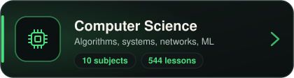
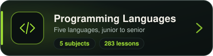
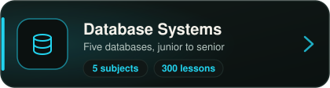
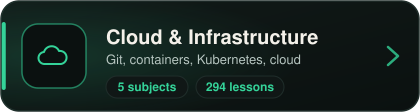
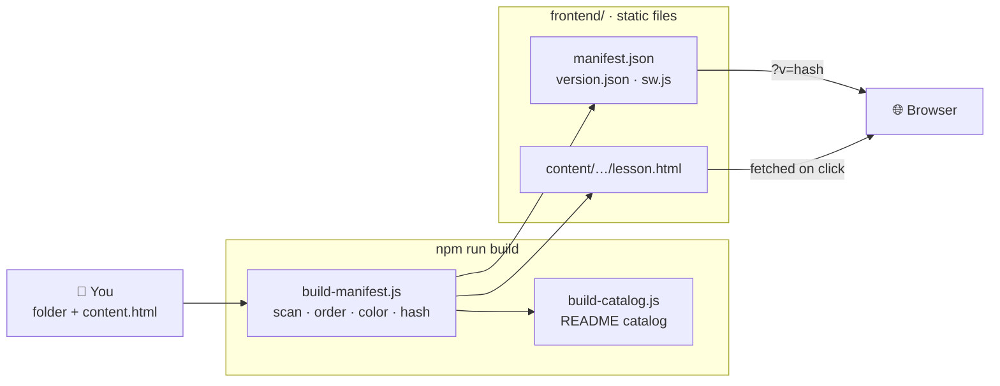
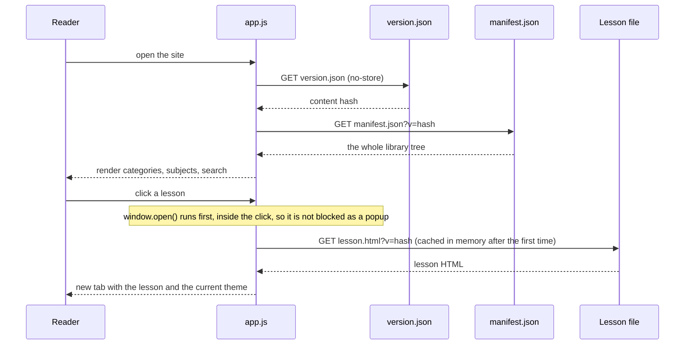

<p align="center">
  
</p>

<p align="center">
  
  
  
  
  
</p>

<p align="center">
  
</p>

<p align="center"><sub><b>CI / CD</b></sub></p>
<p align="center">
  <a href="https://github.com/privateMwb/Canopy/actions/workflows/build.yml">
    
  </a>
  <a href="https://github.com/privateMwb/Canopy/actions/workflows/content.yml">
    
  </a>
  <a href="https://github.com/privateMwb/Canopy/actions/workflows/test.yml">
    
  </a>
  <a href="https://github.com/privateMwb/Canopy/actions/workflows/deploy.yml">
    
  </a>
  <a href="https://github.com/privateMwb/Canopy/actions/workflows/release.yml">
    
  </a>
</p>

<p align="center"><sub><b>Code Quality &amp; Safety</b></sub></p>
<p align="center">
  <a href="https://github.com/privateMwb/Canopy/actions/workflows/lint.yml">
    
  </a>
  <a href="https://github.com/privateMwb/Canopy/actions/workflows/codeql.yml">
    
  </a>
</p>

<p align="center">
  
</p>

<p align="center">Canopy is a self-updating study library: a folder tree of lessons that a single build script turns into a searchable, themeable static site. <b>Add a folder, run <code>npm run build</code>, and it shows up on the page</b> with no frontend code to touch. It covers languages, web development, databases, cloud tooling and core computer science, each subject taught at junior, intermediate and senior level, and it ships as plain HTML, CSS and vanilla JS with no runtime dependencies.</p>

<br>

> [!NOTE]
> **Status: pre-release (`0.1.0`).** The library, the build, content validation, the test suite and the CI
> workflows are in place. There is no tagged release and no live site yet: the Pages workflow is ready, but
> **GitHub Pages has to be switched to "GitHub Actions"** in the repository settings first (see
> [Deployment](#deployment)). Everything below works locally today.

<br>

## 📑 Table of Contents

- [Features](#features)
- [What's Inside](#whats-inside)
- [How It Works](#how-it-works)
- [Requirements](#requirements)
- [Installation](#installation)
- [Quick Start](#quick-start)
- [Adding Content](#adding-content)
- [The Site](#the-site)
- [Project Structure](#project-structure)
- [Development](#development)
- [Continuous Integration](#continuous-integration)
- [Deployment](#deployment)
- [Design Notes](#design-notes)
- [Documentation](#documentation)
- [Contributing](#contributing)
- [Changelog](#changelog)
- [Security](#security)
- [License](#license)

<br>

## <a id="features"></a>✨ Features

- **Self-updating library** — the folder tree under `content/` is the source of truth. `scripts/build-manifest.js` scans it, orders it, colors it and writes the manifest the site reads, so adding a lesson, stage or subject never touches `app.js`.
- **Page or shelf** — a folder either holds a lesson (`content.html`) or holds more folders, never both. The build enforces it and the validator reports a violation instead of silently hiding the page.
- **Search and an A-Z bar** — client-side search over the whole manifest, a letter filter, and an `A↓Z` button to force alphabetical order over the authored order.
- **Light and dark themes** — the page and every lesson follow the reader's choice; the site stamps the current theme into a lesson as it opens.
- **Progress that stays in your browser** — opened lessons and last position are kept per subject in `localStorage`. No accounts, nothing leaves the device.
- **Offline fallback** — a generated service worker serves the network first and falls back to its cache when the connection is gone.
- **Download a subject as a `.zip`** — folders marked `compileRoot` get a one-click archive, built in the browser with a pinned JSZip.
- **Reproducible builds** — the content version is a hash of file *contents*, not timestamps, so a fresh clone rebuilds byte-for-byte what is committed. `npm run check` proves it.
- **Content validation with teeth** — `npm run validate` rejects duplicate lesson and stage numbers, shelves that also hold a page, empty folders, malformed `meta.json`, and any `<script>`, inline handler or `javascript:` link in a lesson.
- **Tested and checked in CI** — a `node:test` suite, oxlint, CodeQL, a generated-files sync check and a content check run on every pull request.
- **No runtime dependencies** — static files you can host anywhere. Node is only needed for the build and the tooling.

<div align="right"><a href="#-table-of-contents"></a></div>

## <a id="whats-inside"></a>📚 What's Inside

Each subject runs from junior to senior, with a curriculum overview to start.

<!-- Generated by `npm run build` from each folder's meta.json. Edit that, not this block. -->
<!-- CATALOG:START -->
<p align="center">
  
  
  
</p>

<p align="center"><sub>Tap a category to browse its subjects</sub></p>

<p align="center">
  <a href="docs/catalog/computer-science.md"></a>
</p>

<p align="center">
  <a href="docs/catalog/programming-languages.md"></a>
</p>

<p align="center">
  <a href="docs/catalog/web-development.md"></a>
</p>

<p align="center">
  <a href="docs/catalog/database-systems.md"></a>
</p>

<p align="center">
  <a href="docs/catalog/cloud-infrastructure.md"></a>
</p>
<!-- CATALOG:END -->

<div align="right"><a href="#-table-of-contents"></a></div>

## <a id="how-it-works"></a>🧠 How It Works

You edit files under `content/`. One script reads them and writes the generated files the static site needs; the browser loads those and fetches a lesson only when it is clicked.



What happens when a reader opens a lesson:



The build rules, the manifest shape, versioning and the security model are written up in [docs/ARCHITECTURE.md](docs/ARCHITECTURE.md).

<div align="right"><a href="#-table-of-contents"></a></div>

## <a id="requirements"></a>📋 Requirements

- Node.js 20 or newer, for the build, the validator, the linter and the tests (CI runs 20 and 22)
- Git
- *(Optional)* Python 3, only for `npm run serve`; any static file server works instead
- A modern browser to read the site. There is nothing to install for readers

<div align="right"><a href="#-table-of-contents"></a></div>

## <a id="installation"></a>📦 Installation

```bash
git clone https://github.com/privateMwb/Canopy.git
cd Canopy
npm ci          # dev tooling only (oxlint); Canopy has no runtime dependencies
```

<div align="right"><a href="#-table-of-contents"></a></div>

## <a id="quick-start"></a>🚀 Quick Start

```bash
npm run serve        # http://localhost:8080
```

That serves the committed `frontend/` folder, so the site works straight after cloning. Check that your copy is healthy with the same checks CI runs:

```bash
npm run verify       # validate content, check generated files, lint, test
```

No Python? Serve `frontend/` with anything you like:

```bash
npx serve frontend   # or: cd frontend && python3 -m http.server 8080
```

<div align="right"><a href="#-table-of-contents"></a></div>

## <a id="adding-content"></a>➕ Adding Content

Folders become cards. A lesson is a leaf folder with a `content.html`:

```
content/categories/programming-languages/rust/
├── meta.json                       title, description, order, colors, icon
└── junior/
    └── stage-1.1-getting-started/
        ├── meta.json
        ├── 01-installing-rust/
        │   └── content.html        one self-contained HTML page
        └── 02-ownership-basics/
            └── content.html
```

```json
{
  "title": "Rust",
  "description": "Ownership, borrowing and fearless concurrency.",
  "order": 6
}
```

Then rebuild and verify:

```bash
npm run build        # regenerates manifest, version, service worker, lesson copies and the README catalog
npm run verify       # the checks CI will run
```

No `meta.json`? The folder name is title-cased and given a palette color. The rules (naming, `NN-slug` and `stage-X.Y-slug`, the page-or-shelf rule, no scripts in lessons), every `meta.json` field and the lesson page format are in [docs/CONTENT.md](docs/CONTENT.md).

> [!TIP]
> `npm run validate` explains what is wrong in plain terms, for example `lessons share number 03` or
> `has content.html AND 4 subfolder(s)`. Run it before you build.

<div align="right"><a href="#-table-of-contents"></a></div>

## <a id="the-site"></a>🖥️ The Site

A static single-page app with hash routing (`#/path/...`), so it needs no server rewrites and works under a subpath such as `https://user.github.io/Canopy/`.

| Element | What it does |
|---|---|
| **Library home** | One card per category, then per subject, drawn from the manifest with each folder's colors and icon |
| **Search** | Filters the current view as you type, across titles and descriptions |
| **A-Z bar and sort** | Jump to a letter, or press `A↓Z` to override the authored order |
| **Lesson tab** | A lesson opens in a new tab, themed to match the site. Each lesson is fetched once per visit and cached in memory |
| **Theme toggle** | Light or dark, remembered in `localStorage` and applied before first paint |
| **Progress** | Per-subject progress and last position, stored only in your browser |
| **Download as .zip** | On folders marked `compileRoot`, bundles the subject's lessons client-side |
| **Offline fallback** | A generated service worker (network first, cache on failure) with a versioned cache that is cleaned up on update |

If `localStorage` is unavailable (private browsing, a full quota), the site still works; progress and theme just aren't remembered.

<div align="right"><a href="#-table-of-contents"></a></div>

## <a id="project-structure"></a>🗂️ Project Structure

```
Canopy/
├── content/categories/     The source of truth: category / subject / level / stage / lesson
│   └── …/<lesson>/         content.html (the page) and an optional meta.json
├── frontend/               The site. Host this folder as-is
│   ├── index.html          App shell (asset stamps are written by the build)
│   ├── app.js              Routing, search, themes, progress, lesson tabs, zip download
│   ├── styles.css  icons.js  site.json  vercel.json
│   ├── manifest.json       ┐
│   ├── version.json        │ Generated by `npm run build`,
│   ├── sw.js               │ committed on purpose so hosting
│   └── content/            ┘ needs no build step
├── scripts/
│   ├── build-manifest.js   Scans content/, writes the generated files; --check verifies them
│   ├── build-catalog.js    Writes the "What's Inside" cards and the catalog pages
│   ├── validate-content.js Lints content/ (meta.json, duplicates, scripts, links)
│   └── sw.template.js      Service worker template
├── tests/                  node:test suite for the build, the catalog and the validator
├── docs/                   CONTENT.md, ARCHITECTURE.md, DEPLOYMENT.md,
│   └── catalog/            Generated category and subject pages (linked from "What's Inside")
├── .github/                Workflows, README assets, CODEOWNERS, Dependabot,
│                           assets/ (banner, divider, back-to-top, generated category cards),
│                           rulesets/ (branch and release-tag rulesets)
│
├── package.json            Scripts (build, check, validate, lint, test, serve, verify)
├── .oxlintrc.json
├── README.md
├── CONTRIBUTING.md
├── CHANGELOG.md
├── SECURITY.md
└── LICENSE
```

<div align="right"><a href="#-table-of-contents"></a></div>

## <a id="development"></a>🛠️ Development

Every task is an npm script:

| Command | What it does |
|---|---|
| `npm run build` | Scans `content/` and regenerates `manifest.json`, `version.json`, `sw.js`, `frontend/content/`, the category cards and the catalog pages |
| `npm run check` | Fails if the committed generated files, the README cards or the catalog pages differ from what `content/` would produce |
| `npm run validate` | Lints `content/`: `meta.json` shape, duplicate numbers, empty folders, scripts and `javascript:` links in lessons |
| `npm run lint` | oxlint over `frontend/` and `scripts/` |
| `npm test` | Runs the `node:test` suite |
| `npm run verify` | validate + check + lint + test: the same things CI runs |
| `npm run serve` | Serves `frontend/` on port 8080 |

**Check only the generated files** (this is what the *Build* workflow runs):

```bash
node scripts/build-manifest.js --check   # rebuilds into a temp copy and compares; touches nothing
node scripts/build-catalog.js --check
```

**Run one test file:**

```bash
node --test tests/validate-content.test.js
```

<div align="right"><a href="#-table-of-contents"></a></div>

## <a id="continuous-integration"></a>🔁 Continuous Integration

Each check is its own workflow with a named job, so a failure says exactly which rule broke. The four marked **required** are what the branch ruleset in `.github/rulesets/main-protection.json` asks for; a second ruleset, `release-tags.json`, protects `v*` tags.

| Workflow | Runs on | What it checks |
|---|---|---|
| **Build** | push to `main`, pull requests | Generated files, the README cards and the catalog pages match `content/` — **required** (*Generated files in sync*) |
| **Content** | push to `main`, pull requests | `scripts/validate-content.js` passes — **required** (*Validate content*) |
| **Lint** | push to `main`, pull requests | oxlint with warnings denied — **required** (*Lint (oxlint)*) |
| **Tests** | push to `main`, pull requests | The `node:test` suite on Node 20 and 22 — **required** (*Unit tests*) |
| **CodeQL** | push to `main`, pull requests, weekly | Security analysis of the JavaScript |
| **Deploy** | push to `main`, manual | Validates, checks sync, then publishes `frontend/` to GitHub Pages |
| **Release** | `v*` tags, manual | Verifies the tree, zips the site and creates a GitHub Release |

None of these workflows has run on GitHub yet; they were validated locally (YAML parses, and every command they run passes), so treat the first run as their first real test.

<div align="right"><a href="#-table-of-contents"></a></div>

## <a id="deployment"></a>☁️ Deployment

The site is the `frontend/` folder. It needs no build step on the host, because the generated files are committed, and every URL is relative.

**GitHub Pages (recommended).** The branch-based Pages option only serves `/` or `/docs`, so it cannot serve `frontend/`. Use the workflow instead: **Settings → Pages → Build and deployment → Source: GitHub Actions**, then push to `main`. `deploy.yml` validates, checks sync and publishes. Once enabled, the site lives at `https://privateMwb.github.io/Canopy/`.

**Vercel.** Import the repo, set **Root Directory** to `frontend`, leave the build command empty. `frontend/vercel.json` adds security headers and `no-cache` on `sw.js`, `version.json`, `manifest.json` and `site.json`.

**Anywhere else.** Publish the `frontend/` directory to Netlify, Cloudflare Pages, S3 or nginx.

```bash
# Releases: tag a version and push the tag
git tag v0.1.0 && git push origin v0.1.0     # release.yml attaches canopy-site-<tag>.zip
```

> [!WARNING]
> **GitHub Pages won't work until its source is set to "GitHub Actions"**, and `deploy.yml` fails until then.
> The ruleset, private vulnerability reporting and Dependabot alerts are also repository settings that the files
> in this repo cannot switch on for you; see [docs/DEPLOYMENT.md](docs/DEPLOYMENT.md).

<div align="right"><a href="#-table-of-contents"></a></div>

## <a id="design-notes"></a>🔬 Design Notes

**Key decisions**

- **Generated files are committed.** `manifest.json`, `version.json`, `sw.js` and `frontend/content/` are build output, but committing them means the site can be hosted from a plain checkout with no build step. The cost is a larger repo and noisier diffs, which the *Build* check pays for by failing any pull request where they have drifted.
- **The version is a content hash.** It used to be derived from file modification times, which differ on every fresh clone, so a clean checkout could never reproduce what was committed. Hashing contents makes the build deterministic and makes `--check` possible.
- **Page or shelf, never both.** A folder with subfolders is a shelf and its `content.html` would be ignored; the validator turns that silent loss into an error.
- **Lessons are script-free by rule.** The site opens a lesson with `document.write()` in a same-origin tab, so a script in a lesson would run with the site's privileges. `validate-content.js` rejects `<script>`, inline `on…=` handlers and `javascript:` links, and escaped code samples (`&lt;script&gt;`) are fine.
- **Hash routing.** `#/path/...` needs no server-side rewrites and works under any subpath, which is what lets one folder deploy to Pages, Vercel or a bare file server unchanged.
- **Network first, cache second.** The service worker prefers fresh files and only falls back to its cache offline, so a content update is never hidden behind a stale cache. Every request is also cache-busted with `?v=<hash>`.
- **Nothing but text reaches the page unescaped.** Every title and description from `meta.json` goes through `escapeHtml` before it is written into HTML.

**Known limits** — progress and theme live in the browser's `localStorage`, so they don't sync across devices. The site needs a network for Google Fonts and, for zip downloads, a pinned JSZip from cdnjs. A node's "updated" date comes from file modification time, so on a fresh clone it reflects the checkout rather than the edit; the sync check ignores it for that reason. Lessons have no deep links yet, and there is no published screenshot or live demo.

<div align="right"><a href="#-table-of-contents"></a></div>

## <a id="documentation"></a>📖 Documentation

| Document | What's inside |
|---|---|
| [docs/CONTENT.md](docs/CONTENT.md) | The authoring guide: folder rules, every `meta.json` field, the lesson page format, validator messages |
| [docs/ARCHITECTURE.md](docs/ARCHITECTURE.md) | How it works: the build, the manifest, versioning and caching, the frontend, the security model, the CI map |
| [docs/DEPLOYMENT.md](docs/DEPLOYMENT.md) | Hosting: GitHub Pages, Vercel, other hosts, releases and recommended repository settings |
| [CONTRIBUTING.md](CONTRIBUTING.md) | Setup, the checks to run, writing lessons and the pull request flow |
| [SECURITY.md](SECURITY.md) | The security model, what is in scope, and how to report a vulnerability |
| [CHANGELOG.md](CHANGELOG.md) | Notable changes |

<div align="right"><a href="#-table-of-contents"></a></div>

## <a id="contributing"></a>🤝 Contributing

Issues and pull requests are welcome. [CONTRIBUTING.md](CONTRIBUTING.md) covers setup, running the checks and the lesson rules. In short:

- Edit the source under `content/`, never the generated files, then run `npm run build`
- Run `npm run verify` before opening a pull request: CI enforces every part of it
- Lessons must be script-free and follow the naming rules in [docs/CONTENT.md](docs/CONTENT.md)
- If you change `frontend/app.js`, escape any `meta.json` text with `escapeHtml` and add a test for build or validator changes

<div align="right"><a href="#-table-of-contents"></a></div>

## <a id="changelog"></a>📝 Changelog

Notable changes are recorded in [CHANGELOG.md](CHANGELOG.md); release notes are published on the [Releases](https://github.com/privateMwb/Canopy/releases) page once a version is tagged.

<div align="right"><a href="#-table-of-contents"></a></div>

## <a id="security"></a>🔒 Security

Please don't report a suspected vulnerability in a public issue. Use GitHub's private reporting instead: this repository's **Security** tab, then **Report a vulnerability**, so it can be fixed before it's disclosed. Details are in [SECURITY.md](SECURITY.md).

> [!WARNING]
> Lessons open **same-origin** with the site, so they are trusted code. Contributions of lessons are reviewed
> for that reason, and the validator refuses scripts, inline handlers and `javascript:` links. Read the model in
> [SECURITY.md](SECURITY.md) before hosting content you did not write.

<div align="right"><a href="#-table-of-contents"></a></div>

## <a id="license"></a>📄 License

MIT — see [LICENSE](LICENSE) for details.

<p align="center">
  
</p>

<p align="center">
  <sub>Built with plain HTML, CSS and JavaScript</sub>
</p>

<p align="center">
  <a href="#-table-of-contents"></a>
</p>
